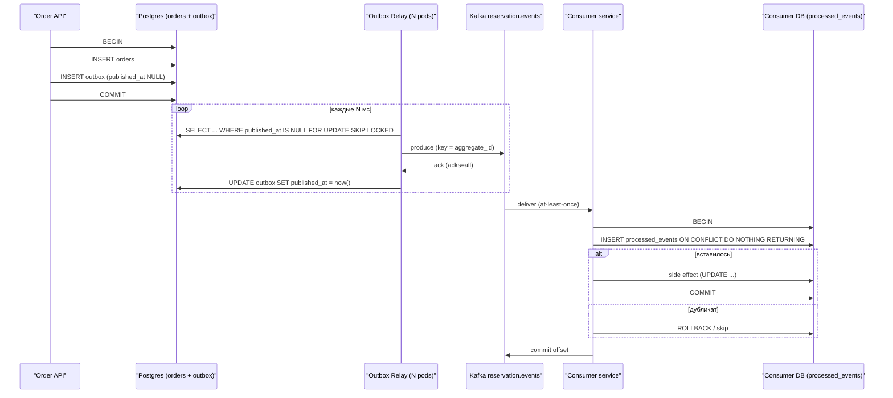

# PostgreSQL для Senior Backend собеса

Практический конспект по коду из `apps/reservation/src/pg-learn/` (knex, схема `pg_learn`). Каждый раздел: **Суть → SQL → Ловушки собеса → Эндпоинт**.

## 🚀 Запуск

```bash
docker compose up -d postgres reservations   # postgres с pg_stat_statements, track_io_timing=on
pnpm pg:migrate     # knex migrate:latest  (с хоста → localhost:5432)
pnpm pg:seed        # generate_series: 100k customers, 500k orders, 1.5M order_items, 1M page_views + VACUUM ANALYZE
pnpm pg:rollback    # откат последней миграции

# внутри docker
docker exec -it reservations pnpm pg:migrate
docker exec -it reservations pnpm pg:seed

curl http://localhost:3000/pg/learn/2-joins
```

Данные специально «с подвохами»: `orders.customer_id` **без индекса** (FK не индексируется автоматически), `orders.status` перекошен (90% `shipped`), customers `90001..100000` без заказов (anti-join), `created_at` монотонный (BRIN, keyset).

## 🧭 Навигация

| # | Эндпоинт | Тема |
|---|---|---|
| **PART 1 — SQL** |||
| 1 | `GET /pg/learn/1-data-types` | numeric vs float, timestamptz, jsonb, identity, uuid v7 |
| 2 | `GET /pg/learn/2-joins` | JOIN-ы, anti/semi-join, NOT IN + NULL, LATERAL, размножение строк |
| 3 | `GET /pg/learn/3-join-algorithms` | Nested Loop / Hash / Merge Join |
| 4 | `GET /pg/learn/4-aggregations` | GROUP BY, FILTER, ROLLUP, COUNT-варианты |
| 5 | `GET /pg/learn/5-window-functions` | ROW_NUMBER/RANK, LAG/LEAD, frame ROWS vs RANGE |
| 6 | `GET /pg/learn/6-cte` | MATERIALIZED, рекурсивный CTE, защита от циклов |
| 7 | `GET /pg/learn/7-jsonb` | операторы, GIN jsonb_ops vs jsonb_path_ops, `?` в knex |
| **PART 2 — TRANSACTIONS** |||
| 8 | `GET /pg/learn/8-acid` | Atomicity, constraints, WAL, transactional DDL |
| 9 | `GET /pg/learn/9-isolation` | RC / RR / SERIALIZABLE, lost update, write skew |
| 10 | `GET /pg/learn/10-locks` | FOR UPDATE, NOWAIT, SKIP LOCKED, advisory locks |
| 11 | `GET /pg/learn/11-deadlock` | 40P01, порядок захвата блокировок |
| 12 | `GET /pg/learn/12-mvcc` | xmin/xmax, VACUUM, HOT, wraparound, bloat |
| **PART 3 — PERFORMANCE** |||
| 13 | `GET /pg/learn/13-explain` | EXPLAIN (ANALYZE, BUFFERS), типы сканов |
| 14 | `GET /pg/learn/14-btree` | составные, INCLUDE, partial, expression индексы |
| 15 | `GET /pg/learn/15-index-types` | GIN, GiST, BRIN, Hash |
| 16 | `GET /pg/learn/16-index-pitfalls` | почему индекс не используется, CONCURRENTLY |
| 17 | `GET /pg/learn/17-pagination` | OFFSET vs keyset |
| 18 | `GET /pg/learn/18-batching` | N+1, unnest, COPY, upsert, RETURNING |
| **PART 4 — DISTRIBUTED** |||
| 19 | `POST /pg/learn/19-outbox` | Transactional Outbox → Kafka |
| 20 | `POST /pg/learn/20-idempotency` | Inbox, Saga vs 2PC |
| **PART 5 — OPS & SCALING** |||
| 21 | `GET /pg/learn/21-partitioning` | декларативное партиционирование, pruning |
| 22 | `GET /pg/learn/22-scaling` | PgBouncer, репликация, шардинг, failover |
| 23 | `GET /pg/learn/23-monitoring` | pg_stat_activity, pg_stat_statements, cache hit |

---

## ⚖️ Knex vs TypeORM (и остальные)

**TypeORM — плюсы:**
- Entities + декораторы, репозитории, быстрый CRUD «из коробки».
- Генерация миграций по diff-у entity ↔ схема.
- Хорошо ложится в DI NestJS (`@InjectRepository`).

**TypeORM — минусы (то, что ждут от senior):**
- **Leaky abstraction**: всё сложнее CRUD всё равно пишется через `QueryBuilder`/raw, но уже с костылями.
- **N+1** через lazy relations / `eager` по умолчанию, неочевидные `JOIN`-ы, декартово произведение при нескольких `relations`.
- Слабый контроль сгенерированного SQL; результат `QueryBuilder` типизирован слабо (`getRawMany()` → `any`).
- Генерация миграций местами бажная (лишние `DROP/ADD`, enum-ы, индексы, default-ы) — всё равно ревьюишь руками.
- Postgres-фичи через боль: CTE, window functions, `LATERAL`, `FOR UPDATE SKIP LOCKED`, партиционирование, `EXCLUDE`, partial/expression индексы, нюансы `ON CONFLICT ... DO UPDATE ... WHERE`.
- Проект развивается рывками, issue висят годами.

**Knex:**
- Тонкий query builder: SQL остаётся видимым, `.toSQL()` / `DEBUG=knex:query`.
- `knex.raw()` для всего, что builder не умеет — без потери транзакции/пула.
- Транзакции с уровнем изоляции: `knex.transaction(fn, { isolationLevel: 'serializable' })`.
- Миграции/сиды как код (`up/down`), без магии diff-а.
- Пул через `tarn` (min/max, acquireTimeout).
- Минус: нет типов результатов «из коробки», нет identity map/relations.

**Когда что:**

| Инструмент | Когда |
|---|---|
| TypeORM / MikroORM | CRUD-админки, простая доменная модель, команда без сильного SQL |
| Prisma | Быстрый старт, отличный DX и типы; но свой движок, ограниченный raw, сложные запросы — через `$queryRaw` |
| **Kysely** | Type-safe query builder: типы выводятся из схемы, SQL контролируешь ты. Лучший выбор для «SQL-first + TS» |
| Drizzle | SQL-like API + типы + миграции, лёгкий, популярен в новых проектах |
| Knex | Зрелый, гибкий builder + миграции; типизация слабее Kysely |
| raw `pg` / `postgres.js` | Максимальный контроль, hot path, high-load |

**Наш выбор:** knex — потому что изучаем **Postgres**, а не ORM. Каждый запрос виден как есть, `EXPLAIN` можно вставить в любой эндпоинт.

> Senior-ответ на «какую ORM выберете?»: «Зависит от домена. Для сложных запросов и high-load — query builder (Kysely/Knex) + raw SQL, ORM допускаю для CRUD-части. Главное — команда должна понимать SQL, который уходит в базу, и смотреть `pg_stat_statements`».

---

## 🗺️ Карта ACID в микросервисах

Локальная транзакция Postgres даёт ACID **внутри одного сервиса**. Между сервисами ACID нет — есть eventual consistency, собранная из: Outbox (атомарно сохранить событие) + at-least-once доставка Kafka + Inbox (идемпотентная обработка).



| | 2PC (XA) | Saga | Outbox + Inbox |
|---|---|---|---|
| Консистентность | Строгая (atomic commit) | Eventual, через компенсации | Eventual, гарантирует доставку события |
| Блокировки | Держатся до решения координатора | Только локальные | Только локальные |
| Отказ координатора | Участники зависают в `prepared` | Оркестратор хранит состояние, продолжает | Relay просто перезапускается |
| Доступность | Низкая | Высокая | Высокая |
| Сложность | Инфраструктурная (XA, recovery) | Доменная (компенсации, semantic lock) | Средняя (relay, dedup) |
| Где применять | Почти нигде между микросервисами | Бизнес-процессы из N шагов | Фундамент для Saga/event-driven |

Saga **использует** Outbox/Inbox как транспорт: каждый шаг саги = локальная транзакция + событие через outbox.

---

## 🔍 Как читать EXPLAIN и EXPLAIN ANALYZE

`EXPLAIN` показывает план, составленный оптимизатором на основе статистики `pg_statistic`. `EXPLAIN (ANALYZE, BUFFERS)` **реально выполняет запрос** (для `UPDATE/DELETE` оборачивать в `BEGIN ... ROLLBACK`!) и выводит фактическое время и статистику страниц буферного пула.

### Анатомия строки плана
```text
Seq Scan on orders  (cost=0.00..18450.00 rows=50000 width=48) (actual time=0.015..45.120 rows=45120 loops=1)
  Filter: (status = 'new'::order_status)
  Rows Removed by Filter: 454880
  Buffers: shared hit=4210 read=1840
```
- **cost=0.00..18450.00**: `0.00` — startup cost (затраты до отдачи первой строки); `18450.00` — total cost (до отдачи последней строки). Единицы — условные `page_cost` (`seq_page_cost=1.0`, `random_page_cost=4.0`, `cpu_tuple_cost=0.01`).
- **rows vs actual rows**: `rows=50000` — оценка планировщика; `actual rows=45120` — факт.
- **loops=N**: сколько раз узел выполнялся. **Actual rows и time на шаге умножаются на loops!** Если `actual rows=1`, но `loops=10000`, узел обработал 10 000 строк.
- **Buffers**:
  - `shared hit`: страницы взяты из RAM (`shared_buffers`). Быстро (наносекунды).
  - `shared read`: страницы прочитаны с диска (или page cache ОС). Медленно.
  - `temp read / temp write`: сброс данных на диск из-за нехватки `work_mem` (сортировка, хэш-таблица).

### 🚩 Красные флаги в плане
1. **Расхождение `rows` и `actual rows` в 10+ раз**: планировщик ошибается в оценке кардинальности из-за устаревшей статистики (`VACUUM ANALYZE`) или коррелированных столбцов (решение: `CREATE STATISTICS`).
2. **`Rows Removed by Filter` огромный**: прочитано 500k строк, выброшено 490k. Нужен B-Tree индекс или partial индекс.
3. **`Sort Method: external merge Disk`**: сортировка не влезла в `work_mem` и ушла в temp files на диск. Решение: увеличить `work_mem` локально (`SET LOCAL work_mem = '64MB'`).
4. **`Hash Batches > 1`**: хэш-таблица для Hash Join не влезла в `work_mem`, сброшена на диск.
5. **Nested Loop с большим `loops` и Seq Scan на внутреннем узле**: декартова смерть `O(N * M)`.

---

# 🎓 ЧАСТЬ 1: SQL И РЕЛЯЦИОННАЯ МОДЕЛЬ

---

## 📌 Шаг 1: Типы данных и Senior-подводные камни

### Суть
- **`numeric(p, s)` vs `float4/float8`**: `float` — приближенные числа IEEE 754. `0.1 + 0.2 != 0.3`. Для денег, балансов и цен — **только** `numeric` или целочисленные центы в `bigint`. `numeric` вычисляется программно (на CPU медленнее float в 5–10 раз).
- **`timestamptz` vs `timestamp`**: `timestamptz` хранит время всегда в **UTC** (8 байт). При выводе форматирует его с учётом `TimeZone` текущей сессии клиента. `timestamp` без пояса отбрасывает часовой пояс — в микросервисах приводит к сдвигам дат. Всегда использовать `timestamptz`.
- **`text` vs `varchar(n)` vs `char(n)`**: в Postgres все три используют одну внутреннюю структуру хранения `varlena` (1 или 4 байта оверхед на длину). По скорости разницы нет. `varchar(n)` тратит CPU на валидацию длины при каждой записи и требует эксклюзивной блокировки `AccessExclusiveLock` при увеличении `n` в ранних версиях. Предпочтителен `text` с `CHECK (length(col) <= N)`.
- **`GENERATED ALWAYS/BY DEFAULT AS IDENTITY` vs `SERIAL`**: `identity` — стандарт SQL:2003 (начиная с PG 10). Последовательность жестко привязана к столбцу (`DROP TABLE` удаляет её), невозможно случайно вставить значение без явного флага, права доступа не текут. `SERIAL` — устаревший псевдотип.
- **`UUID v4` vs `UUID v7`**: v4 генерируется полностью случайно -> вставки размазываются по всему дереву B-Tree, вымывая страницы из `shared_buffers` и вызывая page splits. UUID v7 хранит Unix timestamp в старших 48 битах -> монотонно растет, страницы B-tree заполняются последовательно, как у `bigint`.

### SQL
```sql
-- Демонстрация потери точности float vs точность numeric
SELECT
  (0.1::float8 + 0.2::float8) = 0.3::float8  AS float_loss,   -- false!
  (0.1::numeric + 0.2::numeric) = 0.3::numeric AS numeric_exact; -- true!

-- Генерация identity-колонки (стандарт SQL)
CREATE TABLE payments (
  id bigint GENERATED ALWAYS AS IDENTITY PRIMARY KEY,
  amount numeric(12, 2) NOT NULL CHECK (amount >= 0),
  paid_at timestamptz NOT NULL DEFAULT now()
);
```

### ⚠️ Ловушки собеса
- **Q: Что быстрее в Postgres: `text` или `varchar(255)`?**
  - *Junior*: `varchar(255)` быстрее, потому что база резервирует фиксированный размер строки.
  - *Senior*: В Postgres они хранятся одинаково (`varlena`). `varchar(255)` медленнее на микросекунды из-за проверки длины при INSERT/UPDATE. Лимит лучше задавать через `CHECK`, если длина доменная.
- **Q: Почему нельзя использовать UUID v4 как первичный ключ в высоконагруженных таблицах?**
  - *Junior*: UUID занимает 16 байт, а bigint 8 байт — только в этом разница.
  - *Senior*: B-Tree индекс на UUID v4 фрагментируется. Случайные вставки требуют случайного чтения страниц с диска в память. Кэш `shared_buffers` вымывается, начинаются частые page splits (50% заполнение страниц). Решение — UUID v7 или TSID.

▶️ **Эндпоинт:** `curl http://localhost:3000/pg/learn/1-data-types`

---

## 📌 Шаг 2: JOIN-ы, Anti-join, Semi-join, LATERAL и размножение строк

### Суть
- **INNER / LEFT / FULL / CROSS / SELF JOIN**: базовые типы. `CROSS JOIN` = декартово произведение $N \times M$.
- **Anti-Join**: нахождение строк левой таблицы, для которых нет пары в правой.
  - `NOT EXISTS`: оптимален, безопасен при наличии NULL.
  - `LEFT JOIN ... WHERE right.id IS NULL`: классический вариант, оптимизатор часто трансформирует его в тот же план, что и `NOT EXISTS`.
  - `NOT IN (SELECT id FROM ...)` — **ОПАСНОСТЬ**: если в подзапросе окажется хотя бы один `NULL`, всё выражение возвращает `UNKNOWN` и результат будет пустым!
- **Semi-Join**: выборка строк левой таблицы при наличии хотя бы одной пары в правой (`EXISTS (...)`). В отличие от `INNER JOIN`, не дублирует строки левой таблицы при множественных совпадениях.
- **LATERAL JOIN**: коррелированный подзапрос в секции `FROM`. Подзапрос выполняется для каждой строки внешней таблицы и видит её столбцы. Идеален для задачи «Top-N дочерних записей для каждого родителя».
- **Ловушка размножения строк (Row multiplication)**: объединение таблицы 1:N с дочерней таблицей перед агрегацией дублирует метрики родителя (`SUM(orders.total)` умножится на количество позиций `order_items`).

### SQL
```sql
-- LATERAL: топ-2 последних заказа для каждого VIP-клиента
SELECT c.id, c.full_name, ord.id AS order_id, ord.total
FROM pg_learn.customers c
CROSS JOIN LATERAL (
  SELECT o.id, o.total
  FROM pg_learn.orders o
  WHERE o.customer_id = c.id
  ORDER BY o.created_at DESC
  LIMIT 2
) ord
WHERE c.is_vip = true;

-- Ловушка NOT IN с NULL
SELECT * FROM pg_learn.customers
WHERE id NOT IN (SELECT customer_id FROM pg_learn.orders WHERE customer_id IS NULL); -- вернет ПУСТОЙ результат!
```

### ⚠️ Ловушки собеса
- **Q: В чем разница между `NOT IN` и `NOT EXISTS`?**
  - *Junior*: Никакой, просто разный синтаксис.
  - *Senior*: По трехзначной логике SQL `value NOT IN (1, 2, NULL)` эквивалентно `value != 1 AND value != 2 AND value != NULL`. Сравнение с NULL дает `UNKNOWN`, всё условие схлопывается в `UNKNOWN` (false). `NOT EXISTS` работает по наличию строк и игнорирует NULL внутри выборки.
- **Q: Как посчитать общую сумму заказов и общее количество купленных товаров по клиенту без задвоения?**
  - *Junior*: `SELECT c.id, SUM(o.total), COUNT(oi.id) FROM customers c JOIN orders o ... JOIN order_items oi GROUP BY c.id`.
  - *Senior*: Этот запрос умножит сумму заказов на количество товаров в заказе. Нужно либо агрегировать дочерние таблицы в CTE/подзапросах до JOIN, либо использовать подзапросы в SELECT.

▶️ **Эндпоинт:** `curl http://localhost:3000/pg/learn/2-joins`

---

## 📌 Шаг 3: Алгоритмы соединений (Join Algorithms)

### Суть
- **Nested Loop**:
  - Внешний цикл по таблице A, для каждой строки ищется совпадение в таблице B.
  - Идеален, когда внешняя таблица мала (десятки-сотни строк), а по внутренней таблице есть эффективный B-Tree индекс: $O(M \cdot \log N)$.
  - Катастрофичен при больших неиндексированных таблицах: $O(M \cdot N)$.
- **Hash Join**:
  - Строит in-memory хэш-таблицу по меньшей таблице в пределах `work_mem`. Затем однократно сканирует большую таблицу и зондирует хэш-таблицу: $O(M + N)$.
  - Работает **только** для условий эквивалентности (`=`).
  - Если хэш-таблица не влезает в `work_mem`, переключается в многопроходный режим (Batches > 1) со сбросом бакетов на диск.
- **Merge Join**:
  - Сортирует оба набора по ключу соединения (или берет их уже отсортированными из B-Tree индексов) и одновременно «прокручивает» оба потока: $O(M \log M + N \log N)$, либо $O(M + N)$ при наличии индексов.
  - Эффективен для больших объемов данных при наличии индексов и для диапазонов.

### SQL
```sql
-- Управление оптимизатором в рамках текущей транзакции/сессии
SET LOCAL enable_hashjoin = off;
SET LOCAL enable_mergejoin = off;
-- Теперь оптимизатор вынужден построить Nested Loop
EXPLAIN (ANALYZE, BUFFERS)
SELECT c.full_name, o.total
FROM pg_learn.customers c
JOIN pg_learn.orders o ON o.customer_id = c.id
WHERE c.id BETWEEN 1 AND 50;
```

### ⚠️ Ловушки собеса
- **Q: Почему планировщик выбрал Hash Join вместо B-Tree индекса?**
  - *Junior*: Потому что Hash Join всегда быстрее B-tree.
  - *Senior*: Выборка возвращает значительный процент таблицы (>10-20%). Потоковое последовательное чтение таблицы блоками по 8KB с построением хэш-таблицы дешевле, чем тысячи случайных переходов по B-Tree страницам (`random_page_cost=4.0` против `seq_page_cost=1.0`).
- **Q: Что означает `Batches: 4` в узле Hash Join?**
  - *Junior*: Запрос разбился на 4 параллельных потока.
  - *Senior*: Хэш-таблица превысила `work_mem`. Оптимизатор разбил данные на 4 пакета и сбросил промежуточные бакеты на диск во временные файлы. Запрос уперся в дисковый IO.

▶️ **Эндпоинт:** `curl http://localhost:3000/pg/learn/3-join-algorithms`

---

## 📌 Шаг 4: Агрегации, FILTER, ROLLUP, CUBE и варианты COUNT

### Суть
- **`GROUP BY` vs `HAVING`**: `WHERE` фильтрует строки **до** группировки (отсекает лишнее на этапе сканирования). `HAVING` фильтрует результаты **после** вычисления агрегатов.
- **Aggregate `FILTER (WHERE ...)`**: стандартный синтаксис SQL:2003. Заменяет костыльные конструкции `COUNT(CASE WHEN ... THEN 1 END)`. Вычисляется эффективнее и читается на порядок чище.
- **`ROLLUP` / `CUBE` / `GROUPING SETS`**: расчет промежуточных и общих итогов за **один проход** по данным. Избавляет от необходимости писать тяжелые объединения `UNION ALL` с повторным сканированием таблицы.
- **`COUNT(*)` vs `COUNT(col)` vs `COUNT(DISTINCT col)`**:
  - `COUNT(*)`: считает все кортежи, вне зависимости от содержимого.
  - `COUNT(col)`: проверяет каждую строку на `col IS NOT NULL`.
  - `COUNT(DISTINCT col)`: держит хэш-таблицу уникальных значений в памяти. На больших объемах дорог.

### SQL
```sql
-- Вычисление разных метрик в один проход через FILTER
SELECT
  count(*) AS total_orders,
  count(*) FILTER (WHERE status = 'new') AS new_orders,
  count(*) FILTER (WHERE status = 'shipped') AS shipped_orders,
  sum(total) FILTER (WHERE status = 'paid') AS paid_revenue
FROM pg_learn.orders;

-- Иерархические итоги: Страна -> VIP -> Итого
SELECT country, is_vip, count(*)
FROM pg_learn.customers
GROUP BY ROLLUP (country, is_vip);
```

### ⚠️ Ловушки собеса
- **Q: Чем отличается `COUNT(*)` от `COUNT(1)` в PostgreSQL?**
  - *Junior*: `COUNT(1)` быстрее, так как не читает все столбцы строки.
  - *Senior*: В PostgreSQL разницы нет абсолютно — парсер транслирует `COUNT(1)` в тот же самый внутренний узел агрегации `count(*)`. `COUNT(*)` лексически правильнее.
- **Q: Почему `SELECT COUNT(*) FROM huge_table;` выполняется долго в Postgres, в отличие от MySQL InnoDB?**
  - *Junior*: В Postgres нет индексов на количество строк.
  - *Senior*: Из-за MVCC. Каждая транзакция видит свою версию снимка данных (`xmin/xmax`). Чтобы понять, видна ли строка текущей транзакции, Postgres обязан проверить Visibility Map или просканировать страницы таблицы. Фиксированного счетчика строк в заголовке таблицы нет.

▶️ **Эндпоинт:** `curl http://localhost:3000/pg/learn/4-aggregations`

---

## 📌 Шаг 5: Оконные функции (Window Functions)

### Суть
- Оконные функции вычисляются **после** `WHERE`, `GROUP BY` и `HAVING`, но **до** `ORDER BY`, `DISTINCT` и `LIMIT`.
- **`ROW_NUMBER()` vs `RANK()` vs `DENSE_RANK()`**:
  - `ROW_NUMBER()`: строго уникальный инкремент (1, 2, 3, 4).
  - `RANK()`: одинаковые значения получают один ранг с пропуском последующих (1, 2, 2, 4).
  - `DENSE_RANK()`: одинаковые значения получают один ранг без пропуска (1, 2, 2, 3).
- **`LAG(col, offset)` / `LEAD(col, offset)`**: доступ к предыдущей / следующей строке в окне без `SELF JOIN`.
- **Фрейм окна: `ROWS` vs `RANGE`**:
  - `RANGE BETWEEN UNBOUNDED PRECEDING AND CURRENT ROW` — **дефолт в SQL при наличии `ORDER BY`**. Опасен тем, что проверяет дубликаты значений (peer groups) и не может оптимизироваться в потоковый режим.
  - `ROWS BETWEEN UNBOUNDED PRECEDING AND CURRENT ROW` — инкрементальный расчет бегущей суммы (running total), работает значительно быстрее.

### SQL
```sql
-- Зарплатный ранг по департаментам и бегущий итог
SELECT
  id, full_name, department, salary,
  dense_rank() OVER (PARTITION BY department ORDER BY salary DESC) AS dept_salary_rank,
  lag(salary, 1) OVER (PARTITION BY department ORDER BY salary DESC) AS prev_peer_salary,
  sum(salary) OVER (
    PARTITION BY department
    ORDER BY id
    ROWS BETWEEN UNBOUNDED PRECEDING AND CURRENT ROW
  ) AS running_salary_total
FROM pg_learn.employees;
```

### ⚠️ Ловушки собеса
- **Q: Можно ли фильтровать строки по результату оконной функции в секции `WHERE`?**
  - *Junior*: Да, `WHERE ROW_NUMBER() OVER (...) <= 3`.
  - *Senior*: Нет, оконные функции вычисляются на шаге формирования результирующего набора после `WHERE`. Для фильтрации окно обязательно заворачивается в CTE или подзапрос.
- **Q: В чем коварство дефолтного фрейма `RANGE BETWEEN ...` при подсчете бегущей суммы?**
  - *Senior*: `RANGE` объединяет строки с одинаковым значением ключа сортировки в одну группу «peer group». Если в колонке сортировки есть дубликаты, сумма подскочит сразу для всех одинаковых строк, а сервер потратит лишние ресурсы на поиск границ группы. Всегда пишите `ROWS`.

▶️ **Эндпоинт:** `curl http://localhost:3000/pg/learn/5-window-functions`

---

## 📌 Шаг 6: CTE (Common Table Expressions) и рекурсивные запросы

### Суть
- **Обычный CTE**: синтаксический сахар для читаемости запроса.
- **`MATERIALIZED` vs `NOT MATERIALIZED` (Optimization Fence)**:
  - До PostgreSQL 12 любой CTE был жестким оптимизационным забором: материализовался во временную структуру целиком, внешние условия (`WHERE`) внутрь не проталкивались (predicate pushdown не работал).
  - Начиная с PG 12 CTE по умолчанию **инлайнится** оптимизатором как подзапрос, если на него ссылаются 1 раз.
  - Если нужно принудительно зафиксировать вычисление тяжелого куска (или защитить от повторного выполнения при 2+ вызовах): `WITH t AS MATERIALIZED (...)`.
- **Рекурсивный CTE (`WITH RECURSIVE`)**: состоит из двух частей:
  1. *Анкерный запрос* (выполняется 1 раз).
  2. `UNION [ALL]` + *Рекурсивный запрос* (выполняется, пока предыдущая итерация возвращает строки).
- **Защита от циклов**: если в графе есть петли (A -> B -> A), рекурсия зависнет. Решение: массив посещенных узлов `ARRAY[id]` и проверка `NOT (id = ANY(path))`, либо синтаксис `CYCLE` (PG 14+).

### SQL
```sql
-- Обход дерева организации от CEO вниз с путями и глубиной
WITH RECURSIVE org_tree AS (
  SELECT id, full_name, manager_id, 1 AS depth, ARRAY[id] AS path
  FROM pg_learn.employees
  WHERE manager_id IS NULL -- Анкер: CEO
  UNION ALL
  SELECT e.id, e.full_name, e.manager_id, ot.depth + 1, ot.path || e.id
  FROM pg_learn.employees e
  JOIN org_tree ot ON e.manager_id = ot.id
  WHERE NOT (e.id = ANY(ot.path)) AND ot.depth < 20 -- Защита от циклов
)
SELECT depth, full_name, path FROM org_tree ORDER BY depth;
```

### ⚠️ Ловушки собеса
- **Q: Когда явный `AS MATERIALIZED` необходим в PostgreSQL 12+?**
  - *Junior*: Никогда, оптимизатор всегда лучше знает.
  - *Senior*: В двух случаях: 1) Когда CTE содержит функцию с побочными эффектами (например `random()` или volatile функцию), и мы хотим, чтобы она вызвалась ровно 1 раз, а не на каждую строку внешнего запроса. 2) Когда оптимизатор ошибочно затягивает предикат внутрь тяжелого CTE, выбирая плохой план.

▶️ **Эндпоинт:** `curl http://localhost:3000/pg/learn/6-cte`

---

## 📌 Шаг 7: JSONB: Операторы, GIN Индексы и Knex hazard

### Суть
- **`json` vs `jsonb`**:
  - `json`: хранит точный текст as-is (включая пробелы и порядок ключей). Парсится заново при каждом обращении. Вставка быстрее, чтение медленнее. Не индексируется через GIN.
  - `jsonb`: бинарный разобранный формат (дерево ключей, дубликаты удаляются, ключи сортируются). Медленнее вставка, мгновенный доступ к полям, поддержка специализированных GIN индексов. В проде 99% — `jsonb`.
- **Операторы извлечения**:
  - `-> 'key'`: возвращает `jsonb`.
  - `->> 'key'`: возвращает **`text`**.
  - `#> '{path,0}'`: путь в виде массива, возвращает `jsonb`.
  - `#>> '{path,0}'`: путь в виде массива, возвращает `text`.
- **Оператор вхождения `@>` (containment)**: `attrs @> '{"color": "black"}'` проверяет наличие поддерева. Оптимален для GIN.
- **Типы GIN-индексов**:
  - `jsonb_ops` (дефолт): индексирует ключи и значения отдельно. Поддерживает `?`, `?|`, `?&`, `@>`. Размер больше.
  - `jsonb_path_ops`: хэширует полные пути `{key: value}`. Поддерживает **только `@>`**, но в 2–3 раза компактнее и быстрее.
- **Knex / TypeORM Hazard с оператором `?`**: знак `?` в Postgres проверяет наличие ключа в jsonb: `attrs ? 'color'`. В Knex/драйверах `?` — это позиционный плейсхолдер! Попытка выполнить `raw("attrs ? 'key'")` уронит парсер. Решение: экранировать двойным вопросом: `raw("attrs \\? 'key'")` или писать `@> '{"key": null}'`.

### SQL
```sql
-- Поиск товаров черного цвета по jsonb
SELECT id, title, attrs->>'color' AS color
FROM pg_learn.products
WHERE attrs @> '{"color": "black"}'::jsonb;

-- Создание компактного GIN индекса path_ops
CREATE INDEX idx_products_attrs_path ON pg_learn.products USING gin (attrs jsonb_path_ops);
```

### ⚠️ Ловушки собеса
- **Q: Что вернет выражение `attrs->>'price' > '100'`, если в jsonb поле `price` равно `20`?**
  - *Junior*: Вернет `false`, ведь 20 меньше 100.
  - *Senior*: Вернет `true`! Оператор `->>` возвращает тип `text`. Происходит посимвольное лексикографическое сравнение строк: символ `'2'` больше символа `'1'`, поэтому `'20' > '100'` истинно. Нужно явно приводить тип: `(attrs->>'price')::numeric > 100`.

▶️ **Эндпоинт:** `curl http://localhost:3000/pg/learn/7-jsonb`

---

# 🎓 ЧАСТЬ 2: ТРАНЗАКЦИИ, БЛОКИРОВКИ И MVCC

---

## 📌 Шаг 8: ACID-гарантии и транзакционный DDL

### Суть
- **Atomicity (Атомарность)**: «Всё или ничего». При ошибке внутри транзакции (ошибка констрейнта, сбой сервера) все изменения откатываются.
- **Consistency (Согласованность)**: Переход из одного валидного состояния в другое. Гарантируется констрейнтами: `NOT NULL`, `CHECK`, `FOREIGN KEY`, `UNIQUE` и **`EXCLUDE`**.
  - `EXCLUDE USING gist`: предотвращает двойное бронирование на уровне СУБД (пересечение временных интервалов `tstzrange` для одной комнаты отклоняется ядром БД без race conditions в коде приложения).
- **Isolation (Изоляция)**: Конкурентные транзакции не должны ломать инварианты друг друга (уровни изоляции и MVCC).
- **Durability (Надёжность)**: После `COMMIT` данные гарантированно сохранены.
  - **WAL (Write-Ahead Log)**: любая модификация сначала последовательно пишется в журнал упреждающей записи на диск с вызовом `fsync()`, и лишь затем страницы сбрасываются в буферный пул.
  - `synchronous_commit = off`: транзакция подтверждается до сброса WAL на диск. Увеличивает пропускную способность коротких транзакций в 5–10 раз. Риск: при аппаратном сбое ОС/питания теряются последние транзакции за интервал `wal_writer_delay` (~200ms), но база данных **НЕ повреждается**.
- **Транзакционный DDL**: в PostgreSQL практически любые DDL-команды (`CREATE TABLE`, `ALTER TABLE ADD COLUMN`, `DROP TABLE`) выполняются внутри транзакции! Если миграция из 5 шагов падает на 4-м шаге, база откатывается в исходное состояние целиком (в отличие от MySQL, где DDL делает неявный автокоммит).

### SQL
```sql
-- Демонстрация EXCLUDE constraint: защита от овербукинга
CREATE TABLE pg_learn.room_bookings (
  id bigint GENERATED ALWAYS AS IDENTITY PRIMARY KEY,
  room_id int NOT NULL,
  during tstzrange NOT NULL,
  EXCLUDE USING gist (room_id WITH =, during WITH &&) -- btree_gist
);

-- Попытка вставить пересекающийся интервал завершится ошибкой:
-- ERROR: conflicting key value violates exclusion constraint "room_bookings_room_id_during_excl"
```

### ⚠️ Ловушки собеса
- **Q: Что происходит с DDL при падении миграции в Postgres vs MySQL?**
  - *Junior*: И там, и там нужно вручную удалять созданные таблицы.
  - *Senior*: В Postgres DDL транзакционен: `BEGIN; CREATE TABLE ...; ALTER TABLE ...; COMMIT;` — при падении схема останется чистой. В MySQL DDL автоматически коммитит текущую транзакцию и не откатывается, оставляя базу в «полуразобранном» состоянии.
- **Q: Можно ли ставить `synchronous_commit = off` в production?**
  - *Junior*: Категорически нет, данные повредятся.
  - *Senior*: Можно для некритичных данных (счетчики просмотров, аудит, телеметрия, логи). База гарантированно сохраняет консистентность (структурной порчи не происходит), теряются лишь последние 200–600 мс транзакций при крахе хоста.

▶️ **Эндпоинт:** `curl http://localhost:3000/pg/learn/8-acid`

---

## 📌 Шаг 9: Уровни изоляции: Lost Update и Write Skew

### Суть
- В PostgreSQL **нет грязных чтений** (Read Uncommitted реализован как Read Committed).
- **Read Committed (дефолт)**:
  - Каждый отдельный SQL-запрос видит снимок данных на момент **начала этого запроса**.
  - Аномалии: *Non-repeatable read* (повторный SELECT видит новые данные), *Phantom read* (появились новые строки), *Lost update* (два параллельных `UPDATE account SET balance = balance + 10` могут затереть данные, если расчет шел на бэкенде).
- **Repeatable Read**:
  - Снимок фиксируется на момент **первого исполняемого оператора** транзакции (не на `BEGIN`!). Все последующие запросы видят мир строго на эту миллисекунду.
  - Защищает от *Non-repeatable read*, *Phantom read* и *Lost update*. Если строка изменена параллельной транзакцией, при попытке UPDATE Postgres выбрасывает `ERROR 40001: could not serialize access due to concurrent update`.
  - Подвержен аномалии **Write Skew**.
- **Serializable (SSI — Serializable Snapshot Isolation)**:
  - Имитирует строго последовательное выполнение без реальных монопольных блокировок таблиц (через SIREAD-замки в оперативной памяти).
  - Защищает от всех аномалий, включая **Write Skew**.
  - При конфликте предикатов возвращает `ERROR 40001: could not serialize access due to read/write dependencies`.
  - **ОБЯЗАТЕЛЬНОЕ ТРЕБОВАНИЕ**: код бэкенда обязан иметь цикл повторов (Retry Loop с backoff) для перехвата ошибки `40001`.

### SQL
```sql
-- Классический Write Skew (дежурство врачей: хотя бы 1 должен остаться)
-- Транзакция 1 (Dr. House):
BEGIN TRANSACTION ISOLATION LEVEL SERIALIZABLE;
SELECT count(*) FROM pg_learn.doctors WHERE on_call = true; -- видит 2
UPDATE pg_learn.doctors SET on_call = false WHERE id = 1;

-- Транзакция 2 (Dr. Watson): параллельно
BEGIN TRANSACTION ISOLATION LEVEL SERIALIZABLE;
SELECT count(*) FROM pg_learn.doctors WHERE on_call = true; -- видит 2
UPDATE pg_learn.doctors SET on_call = false WHERE id = 2;

-- Коммит первой пройдет, коммит второй вернет:
-- ERROR 40001: could not serialize access due to read/write dependencies among transactions
```

### ⚠️ Ловушки собеса
- **Q: В какой момент фиксируется снимок данных в `Repeatable Read`?**
  - *Junior*: В момент команды `BEGIN TRANSACTION ISOLATION LEVEL REPEATABLE READ`.
  - *Senior*: В момент выполнения **первого оператора** (SELECT/UPDATE) внутри транзакции. Если между BEGIN и первым SELECT прошло 5 секунд, транзакция увидит состояние на момент SELECT.
- **Q: Как защититься от Lost Update без перевода всей базы в SERIALIZABLE?**
  - *Junior*: Использовать блокировку на уровне Redis.
  - *Senior*: Два пути: 1) Атомарный UPDATE на уровне SQL: `UPDATE accounts SET balance = balance - 100 WHERE id = 1 AND balance >= 100`. 2) Пессимистическая блокировка `SELECT ... FOR UPDATE` в Read Committed.

▶️ **Эндпоинт:** `curl http://localhost:3000/pg/learn/9-isolation`

---

## 📌 Шаг 10: Блокировки: FOR UPDATE, NOWAIT, SKIP LOCKED и Advisory Locks

### Суть
- **Режимы блокировки строк**:
  - `FOR UPDATE`: эксклюзивная блокировка строки. Блокирует любые другие `UPDATE`, `DELETE`, `FOR UPDATE/SHARE`. Конфликтует даже с проверкой внешних ключей.
  - `FOR NO KEY UPDATE`: блокирует строку, но **разрешает параллельные вставки** дочерних записей по внешним ключам (FK), если первичный ключ не менялся. Используется ORM по умолчанию в современных версиях.
  - `FOR SHARE` / `FOR KEY SHARE`: разделяемые блокировки для чтения без изменения.
- **Поведение при ожидании**:
  - Без параметров: транзакция «зависает» и ждет освобождения блокировки вплоть до `statement_timeout` или `lock_timeout`.
  - `NOWAIT`: если строка занята, мгновенно падает с ошибкой `55P03 (lock_not_available)`.
  - `SKIP LOCKED`: **пропускает заблокированные строки** и возвращает только свободные! Фундамент для очередей задач и очередей событий Outbox на несколько конкурирующих worker pods.
- **Advisory Locks (Рекомендательные блокировки)**:
  - Блокировки на уровне приложения по 64-битному ключу `bigint` (или двум 32-битным числам).
  - Живут в памяти Postgres, не привязаны к конкретным таблицам или строкам.
  - `pg_advisory_xact_lock(id)`: автоматически снимается при завершении транзакции.
  - `pg_try_advisory_xact_lock(id)`: возвращает `true/false` без блокирующего ожидания.
  - Альтернатива Redis Redlock: гарантированная согласованность, нет проблем с NTP рассинхронизацией и split-brain. Минус — нагрузка на пул соединений Postgres.

### SQL
```sql
-- Паттерн безопасной очереди задач на N воркеров
SELECT id, aggregate_id, payload
FROM pg_learn.outbox
WHERE published_at IS NULL
ORDER BY id
LIMIT 10
FOR UPDATE SKIP LOCKED;

-- Пользовательский мьютекс транзакции (например, выплата зарплаты пользователю 123)
SELECT pg_try_advisory_xact_lock(123) AS acquired;
```

### ⚠️ Ловушки собеса
- **Q: Чем `FOR NO KEY UPDATE` лучше `FOR UPDATE`?**
  - *Junior*: Ничем, это просто длинный синтаксис.
  - *Senior*: `FOR UPDATE` блокирует добавление дочерних записей в таблицы, ссылающиеся на эту строку по Foreign Key. `FOR NO KEY UPDATE` блокирует только мутацию самой строки, позволяя другим транзакциям вставлять дочерние строки по FK. Это кардинально снижает lock contention.
- **Q: Как организовать параллельную обработку очереди задач без задвоений и без взаимных блокировок?**
  - *Senior*: `SELECT ... WHERE status = 'pending' ORDER BY id LIMIT batch_size FOR UPDATE SKIP LOCKED`. Каждый воркер забирает свободные строки, не ждет соседа и сразу обрабатывает их.

▶️ **Эндпоинт:** `curl http://localhost:3000/pg/learn/10-locks`

---

## 📌 Шаг 11: Deadlock: Причины, детектирование (40P01) и предотвращение

### Суть
- **Причина взаимной блокировки**:
  - Транзакция A захватывает ресурс 1 и ждет ресурс 2.
  - Транзакция B захватывает ресурс 2 и ждет ресурс 1.
  - Образуется замкнутый цикл в графе ожидания блокировок (wait-for graph).
- **Детектирование в Postgres**:
  - Каждая ждущая транзакция запускает таймер `deadlock_timeout` (по умолчанию **1 секунда**).
  - По истечении таймера фоновый процесс проверяет наличие циклов в графе блокировок.
  - При обнаружении цикла Postgres **принудительно обрывает одну из транзакций** с кодом ошибки **`40P01 (deadlock_detected)`**, позволяя второй успешно завершиться.
- **Единственное правильное архитектурное решение**:
  - **Строго детерминированный порядок захвата ресурсов!**
  - При переводе денег между счетами $X$ и $Y$ ресурсы всегда захватываются в порядке возрастания ID: $\min(X, Y) \to \max(X, Y)$.

### SQL
```sql
-- Безопасный перевод денег между счетами Alice (id=1) и Bob (id=2)
-- Всегда сортируем счета перед FOR UPDATE!
SELECT id, balance
FROM pg_learn.accounts
WHERE id IN (1, 2)
ORDER BY id ASC -- Строгий порядок исключает возможность дедлока!
FOR UPDATE;

UPDATE pg_learn.accounts SET balance = balance - 100 WHERE id = 1;
UPDATE pg_learn.accounts SET balance = balance + 100 WHERE id = 2;
```

### ⚠️ Ловушки собеса
- **Q: Могут ли дедлоки происходить на операциях `INSERT`?**
  - *Junior*: Нет, дедлоки бывают только при `UPDATE`.
  - *Senior*: Да! Классический случай — параллельный `INSERT` двух строк в разном порядке в таблицу с уникальным индексом (`UNIQUE`), либо проверка Foreign Key при каскадных связях без индексов.
- **Q: Почему нельзя просто выставить `deadlock_timeout = 10ms`, чтобы база реагировала быстрее?**
  - *Senior*: Построение и анализ графа блокировок в памяти — ресурсоемкая операция на CPU. Если выставить 10 мс, при высокой нагрузке Postgres будет тратить больше времени на проверку графа, чем на полезную работу.

▶️ **Эндпоинт:** `curl http://localhost:3000/pg/learn/11-deadlock`

---

## 📌 Шаг 12: MVCC: xmin, xmax, dead tuples, VACUUM, HOT Updates и Bloat

### Суть
- **MVCC (Multi-Version Concurrency Control)**: читатели никогда не блокируют писателей, а писатели никогда не блокируют читателей. Каждая строка (tuple) имеет заголовок (23 байта) с системными столбцами:
  - `xmin`: ID транзакции, создавшей эту версию строки.
  - `xmax`: ID транзакции, удалившей или обновившей строку (0, если жива).
  - `ctid`: физический адрес кортежа `(номер_страницы, индекс_внутри_страницы)`.
- **Что происходит при `UPDATE`**:
  - Postgres **НЕ перезаписывает** данные на месте!
  - Он помечает старый кортеж (выставляет `xmax = current_xid`) и вставляет **абсолютно новый кортеж** в конец страницы (или на другую страницу) с новым `xmin`.
  - Старая строка становится **мертвой (dead tuple)**, как только все транзакции, которые могли её видеть, завершились.
- **VACUUM vs VACUUM FULL**:
  - Обычный `VACUUM` (и `autovacuum`): удаляет dead tuples и освобождает место **внутри страниц** для будущих вставок. Размер файла на диске **НЕ уменьшается**!
  - `VACUUM FULL`: полностью переписывает таблицу в новый файл. Возвращает место ОС, но захватывает монопольную блокировку **`AccessExclusiveLock`** (таблица недоступна даже для чтения!).
- **HOT Updates (Heap-Only Tuples)**:
  - Если при `UPDATE` **не менялись индексированные столбцы** и на текущей странице есть свободное место (`fillfactor < 100`), новая версия пишется в ту же страницу.
  - Указатель B-Tree индекса не меняется (старый кортеж ссылается на новый через цепочку HOT). Дисковый IO снижается колоссально.
- **Transaction ID Wraparound**:
  - 32-битный счетчик транзакций `xid` ограничен $2^{31} \approx 2.1$ млрд транзакций.
  - Без `autovacuum freeze` при достижении порога база переходит в аварийный режим read-only.
- **Опасность долгих транзакций**:
  - Любая транзакция в статусе `idle in transaction` (например, брошенный коннект пула) удерживает горизонт `xmin`.
  - `autovacuum` не может очистить мертвые строки моложе этого `xmin` для **всей базы**! Таблицы и индексы катастрофически раздуваются (bloat).

### SQL
```sql
-- Просмотр системных столбцов MVCC
SELECT ctid, xmin, xmax, id, balance FROM pg_learn.accounts;

-- Мониторинг раздувания (dead tuples)
SELECT relname, n_live_tup, n_dead_tup, last_vacuum, last_autovacuum
FROM pg_stat_user_tables
WHERE schemaname = 'pg_learn';

-- Оптимизация под частые UPDATE: оставляем 20% свободного места для HOT updates
ALTER TABLE pg_learn.accounts SET (fillfactor = 80);
```

### ⚠️ Ловушки собеса
- **Q: Почему `VACUUM` отработал, но место на диске не освободилось?**
  - *Junior*: Баг в PostgreSQL.
  - *Senior*: Обычный VACUUM не возвращает страницы ОС, он дефрагментирует страницы и помечает пространство в FSM (Free Space Map) как пригодное для повторного использования. Сжать файл на диске может только `VACUUM FULL` (или инструмент без простоя `pg_repack`).
- **Q: Как забытый `BEGIN` без `COMMIT` в бэкенде может уронить прод через 12 часов?**
  - *Senior*: Сессия зависает в `idle in transaction`. Ее `xmin` фиксирует горизонт очистки. Автовакуум перестает удалять dead tuples по всем таблицам. Накапливаются миллионы мертвых строк, B-Tree индексы разбухают, буферный пул вымывается, начинаются тайм-ауты по IO. Решение: `idle_in_transaction_session_timeout = '30s'`.

▶️ **Эндпоинт:** `curl http://localhost:3000/pg/learn/12-mvcc`

---

# 🎓 ЧАСТЬ 3: ПРОИЗВОДИТЕЛЬНОСТЬ, ИНДЕКСЫ И ХАЙЛОАД

---

## 📌 Шаг 13: EXPLAIN: Чтение планов, узлы сканирования и буферы

### Суть
- **Виды сканирования таблиц**:
  - **Seq Scan**: последовательное чтение всей таблицы блок за блоком. Оптимален для мелких таблиц (< 1000 строк) или когда запрос возвращает значительную часть таблицы (> 10–20%).
  - **Index Scan**: спуск по B-Tree дереву до листа $\to$ чтение физического указателя `ctid` (Heap TID) $\to$ случайное чтение страницы таблицы (Heap). Дорогой случайный доступ (`random_page_cost=4.0`).
  - **Index Only Scan**: все запрашиваемые столбцы содержатся в индексе. В таблицу заглядывать не нужно, **ЕСЛИ** Visibility Map подтверждает, что страница «всецело видима» (all-visible) и не содержит мертвых строк. Если в таблице много мертвых кортежей, превращается по стоимости в обычный Index Scan.
  - **Bitmap Index Scan + Bitmap Heap Scan**: двухфазное чтение. Сначала по индексу строится битовая карта страниц в оперативной памяти (TID bitmap), затем страницы таблицы читаются последовательно (Seq-like) без лишних скачков головки диска. Идеален для объединения нескольких условий (`BitmapAnd`, `BitmapOr`).
- **Buffers**: ключевая метрика эффективности. Если `shared read` высокий — запрос упирается в дисковый IO. Если `shared hit` высокий — данные отдаются из оперативной памяти.

### SQL
```sql
-- Полный детальный план с реальным выполнением и буферами
EXPLAIN (ANALYZE, BUFFERS, COSTS, TIMING, SUMMARY)
SELECT c.full_name, count(o.id)
FROM pg_learn.customers c
JOIN pg_learn.orders o ON o.customer_id = c.id
WHERE c.country = 'US'
GROUP BY c.full_name
ORDER BY count(o.id) DESC
LIMIT 5;
```

### ⚠️ Ловушки собеса
- **Q: Что опасного в выполнении `EXPLAIN ANALYZE UPDATE ...` на production базе?**
  - *Junior*: Ничего, он просто анализирует.
  - *Senior*: `EXPLAIN ANALYZE` **РЕАЛЬНО ВЫПОЛНЯЕТ** запрос! Если запустить его с `UPDATE` или `DELETE`, данные в таблице будут реально перезаписаны или удалены. Для тестирования модификаций его оборачивают в транзакцию с откатом: `BEGIN; EXPLAIN ANALYZE UPDATE ...; ROLLBACK;`.
- **Q: В запросе используется B-Tree индекс, но план показывает `Index Scan` вместо ожидаемого `Index Only Scan`. Почему?**
  - *Senior*: Две причины: 1) В `SELECT` попал столбец, которого нет в индексе (нужен `INCLUDE`). 2) Таблица не была очищена `VACUUM`, страницы не помечены как all-visible в Visibility Map, и сервер вынужден ходить в Heap для проверки видимости строк по MVCC (`Heap Fetches > 0`).

▶️ **Эндпоинт:** `curl http://localhost:3000/pg/learn/13-explain`

---

## 📌 Шаг 14: B-Tree Индексы: Составные, INCLUDE, Partial и Expression

### Суть
- **Порядок колонок в составном индексе (Composite Index)**:
  - Действует **правило левого префикса** (Leftmost prefix rule).
  - Столбцы на **точное равенство (`=`)** обязаны стоять **первыми**!
  - Столбцы на **диапазоны (`<`, `>`, `BETWEEN`)** и сортировку (`ORDER BY`) — **в конце**.
  - Индекс `(status, created_at)` отлично работает для `WHERE status = 'new' AND created_at > ...`, но индекс `(created_at, status)` для этого же запроса сможет использовать только первую колонку, выполняя фильтрацию по статусу в памяти!
- **Покрывающий индекс (Covering Index) через `INCLUDE`**:
  - `CREATE INDEX idx ON orders (customer_id) INCLUDE (total, created_at);`
  - Столбцы из `INCLUDE` хранятся **только в листовых страницах B-Tree** (не участвуют в дереве поиска).
  - Дает честный `Index Only Scan`, не раздувая размер промежуточных страниц индекса.
- **Частичный индекс (Partial Index)**:
  - `CREATE INDEX idx ON orders (id) WHERE status = 'new';`
  - Индексирует только те строки, которые удовлетворяют предикату. В нашем датасете статус `new` составляет 5% от 500k строк -> индекс в 20 раз меньше, кешируется в RAM полностью.
- **Функциональный индекс (Expression Index)**:
  - `CREATE INDEX idx ON customers (LOWER(email));`
  - Без него запрос `WHERE LOWER(email) = 'alex@example.com'` обречен на полный Seq Scan.
- **Ловушка внешних ключей (Foreign Key без индекса)**:
  - В PostgreSQL внешний ключ **НЕ создает индекс автоматически**!
  - Если в `orders` столбец `customer_id` не индексирован, то:
    1) Запросы `SELECT * FROM orders WHERE customer_id = 42` идут в Seq Scan.
    2) `DELETE FROM customers WHERE id = 42` блокирует всю таблицу `orders` и сканирует 500k строк для проверки каскада!

### SQL
```sql
-- 1. Составной индекс (равенство первым, диапазон вторым)
CREATE INDEX idx_orders_status_date ON pg_learn.orders (status, created_at);

-- 2. Покрывающий индекс для Index Only Scan
CREATE INDEX idx_orders_cust_covering ON pg_learn.orders (customer_id) INCLUDE (total);

-- 3. Частичный индекс (только неотправленные заказы)
CREATE INDEX idx_orders_unshipped ON pg_learn.orders (id, customer_id) WHERE status IN ('new', 'paid');
```

### ⚠️ Ловушки собеса
- **Q: Почему база игнорирует индекс на колонке `status`, хотя он создан?**
  - *Junior*: Индекс поврежден, нужно сделать REINDEX.
  - *Senior*: Из-за низкой селективности (низкой кардинальности). Если статус `shipped` составляет 90% таблицы, чтение 90% строк через случайные переходы по индексу в разы медленнее, чем простое последовательное чтение таблицы подряд (Seq Scan с упреждающим чтением OS read-ahead).

▶️ **Эндпоинт:** `curl http://localhost:3000/pg/learn/14-btree`

---

## 📌 Шаг 15: Специализированные индексы: GIN, GiST, BRIN, Hash

### Суть
- **GIN (Generalized Inverted Index — Инвертированный индекс)**:
  - Маппинг `элемент -> список документов/строк`.
  - Применение: поля `jsonb`, массивы `text[]`, полнотекстовый поиск `tsvector`, и нечеткий поиск подстрок через расширение `pg_trgm` (`ILIKE '%substring%'`).
  - Медленнее на запись (требует фоновой очереди вставки `gin_pending_list`), но мгновенное чтение.
- **GiST (Generalized Search Tree — Дерево сбалансированного поиска)**:
  - Иерархическое дерево геометрических фигур и интервалов (R-Tree).
  - Применение: координаты PostGIS, диапазоны времени (`tstzrange`), констрейнты `EXCLUDE`.
  - Позволяет искать пересечения (`&&`), включения (`@>`), смежность (`-|-`).
- **BRIN (Block Range Index — Индекс диапазонов блоков)**:
  - Хранит **только минимальное и максимальное значение** для диапазона физических страниц (по умолчанию 128 страниц = 1 MB данных).
  - При поиске отсекает блоки, где значений заведомо нет.
  - **Размер**: на 1 миллион строк B-tree весит ~22 MB, а BRIN — **всего 64 KB**!
  - **Ограничение**: работает **только если данные физически упорядочены на диске** (корреляция $\approx 1.0$ в `pg_stats`), например, автоинкрементные ID, временные ряды логов, аудит.
- **Hash Index**:
  - Поддерживает только оператор строгого равенства `=`.
  - Начиная с PG 10 пишется в WAL и полностью устойчив к сбоям (crash-safe). Компактнее B-tree для очень длинных строк (хэширует значение до 4 байт).

### SQL
```sql
-- Полнотекстовый / триграммный поиск через GIN (pg_trgm)
CREATE EXTENSION IF NOT EXISTS pg_trgm;
CREATE INDEX idx_products_title_trgm ON pg_learn.products USING gin (title gin_trgm_ops);
-- Запрос с ведущим процентом теперь летает по индексу!
SELECT id, title FROM pg_learn.products WHERE title ILIKE '%phone%';

-- BRIN индекс для временных рядов (таблица page_views на 1M строк)
CREATE INDEX idx_page_views_brin ON pg_learn.page_views USING brin (created_at) WITH (pages_per_range = 128);
```

### ⚠️ Ловушки собеса
- **Q: Как ускорить поиск по `ILIKE '%query%'` (с ведущим процентом) в Postgres?**
  - *Junior*: Создать стандартный B-Tree индекс на колонку.
  - *Senior*: Стандартный B-Tree не умеет искать с ведущим `%`. Нужно подключить расширение `pg_trgm` и создать GIN-индекс с операторным классом `gin_trgm_ops`. Он разбивает строки на триграммы и находит совпадения через инвертированный список.

▶️ **Эндпоинт:** `curl http://localhost:3000/pg/learn/15-index-types`

---

## 📌 Шаг 16: Ошибки проектирования индексов и CONCURRENTLY

### Суть
- **Топ причин, почему индекс НЕ используется**:
  1. **Функция на столбце**: `WHERE date(created_at) = '2025-01-01'`. Функция ломает использование B-tree на `created_at`. Решение: диапазон `WHERE created_at >= '2025-01-01' AND created_at < '2025-01-02'`.
  2. **Неявное приведение типов (Implicit Cast)**: `WHERE varchar_col = 123`. Число `123` имеет тип `integer`, Postgres неявно приводит строку к числу `CAST(varchar_col AS integer) = 123` для каждой строки таблицы, вызывая Seq Scan.
  3. **Ведущий wildcard**: `LIKE '%abc'`.
  4. **Условие `OR` по разным столбцам**: `WHERE a = 1 OR b = 2`. Без BitmapOr планировщик свалится в Seq Scan.
  5. **Низкая селективность**: если возвращается >10–15% таблицы.
- **Write Amplification (Цена индексов)**:
  - Каждый лишний индекс замедляет вставки (`INSERT`) и обновления (`UPDATE`).
  - Раздувает размер резервных копий и вымывает страницы из `shared_buffers`.
  - Убивает HOT-обновления.
- **`CREATE INDEX CONCURRENTLY`**:
  - Обычный `CREATE INDEX` берет `ShareLock`, блокируя любые `INSERT`, `UPDATE`, `DELETE` на всё время построения индекса (на таблице в 500M строк это часы простоя!).
  - `CONCURRENTLY` строит индекс в **2 прохода** без блокировки пишущих запросов.
  - **Подводный камень**: `CONCURRENTLY` **нельзя выполнять внутри транзакции** (`BEGIN...COMMIT`). При сбое (таймаут, дедлок) индекс помечается как **`INVALID`** — он занимает место на диске, замедляет вставки, но оптимизатор **не может его использовать**! Необходим ручной `DROP INDEX CONCURRENTLY`.

### SQL
```sql
-- Поиск неиспользуемых индексов (мусор, замедляющий вставки)
SELECT
  schemaname || '.' || relname AS table_name,
  indexrelname AS index_name,
  idx_scan, -- количество использований планировщиком
  pg_size_pretty(pg_relation_size(indexrelid)) AS index_size
FROM pg_stat_user_indexes
WHERE idx_scan = 0 AND indexrelname NOT LIKE '%_pkey'
ORDER BY pg_relation_size(indexrelid) DESC;
```

### ⚠️ Ловушки собеса
- **Q: Что делать, если `CREATE INDEX CONCURRENTLY` упал с ошибкой на проде?**
  - *Junior*: Запустить его заново с тем же именем.
  - *Senior*: В базе остался «инвалидный» индекс (`indisvalid = false` в `pg_index`). Он не ускоряет чтение, но замедляет запись и пожирает диск. Сначала нужно выполнить `DROP INDEX CONCURRENTLY broken_idx_name;` и только затем запускать создание повторно.

▶️ **Эндпоинт:** `curl http://localhost:3000/pg/learn/16-index-pitfalls`

---

## 📌 Шаг 17: Пагинация: Deep OFFSET против Keyset (Cursor) пагинации

### Суть
- **Проблема `OFFSET N LIMIT K`**:
  - Чтобы вернуть 20 строк со смещением 100,000, сервер обязан просканировать **100,020 строк**, отсортировать их и выкинуть первые 100,000.
  - Сложность: $O(OFFSET + LIMIT)$. На глубоких страницах время ответа деградирует от миллисекунд до десятков секунд.
  - **Inconsistent Read (Проблема плавающих данных)**: если во время листания пользователь удалил или добавил строку, на следующей странице пользователь увидит дубликат или пропустит запись.
- **Keyset Pagination (Курсорная пагинация)**:
  - Переход на следующую страницу осуществляется по кортежу последнего виденного элемента:
    `WHERE (created_at, id) < ($last_created_at, $last_id) ORDER BY created_at DESC, id DESC LIMIT 20`.
  - Сервер делает точечный спуск по B-Tree индексу $O(\log N)$ и считывает ровно 20 строк!
  - Сложность: $O(LIMIT)$ — одинаково быстро на 1-й и на 10,000-й странице.
  - Идемпотентность и стабильность: новые строки не ломают порядок просмотра.

### SQL
```sql
-- Keyset pagination по составному индексу (created_at DESC, id DESC)
SELECT id, total, created_at
FROM pg_learn.orders
WHERE (created_at, id) < ('2025-01-15 12:00:00+00'::timestamptz, 45210)
ORDER BY created_at DESC, id DESC
LIMIT 20;
```

### ⚠️ Ловушки собеса
- **Q: В каких случаях Keyset пагинация не подходит?**
  - *Junior*: Она подходит всегда.
  - *Senior*: Она не позволяет пользователю совершить случайный прыжок на произвольную страницу «перейти сразу на 47-ю страницу» в UI без последовательного пролистывания, и требует наличия строго детерминированного уникального порядка сортировки (например, timestamp + primary key).

▶️ **Эндпоинт:** `curl http://localhost:3000/pg/learn/17-pagination`

---

## 📌 Шаг 18: Пакетная обработка (Batching), N+1 и Upsert

### Суть
- **Проблема N+1**: классическая беда ORM (TypeORM/Hibernate). Загрузка 100 заказов, а затем в цикле по заказу 100 запросов за товарами.
  - Решение 1: подгрузка пачкой через `WHERE order_id IN (...)`.
  - Решение 2 (Senior): один запрос с агрегацией дочерних сущностей через `json_agg(json_build_object(...))`. База собирает вложенный JSON на своей стороне за доли миллисекунды.
- **Массовая вставка (Bulk Insert)**:
  - 1000 отдельных `INSERT`: 1000 сетевых roundtrips, 1000 фиксаций в WAL. Медленно.
  - `INSERT INTO ... VALUES (...), (...)`: лучше, но парсер Postgres раздувает AST-дерево в памяти при десятках тысяч параметров ($65535$ limit в некоторых драйверах).
  - **`INSERT ... SELECT * FROM unnest(?::int[], ?::text[])`**: передача массивов типизированных колонок. Быстро, компактно, без лимитов по числу параметров.
  - **`COPY FROM STDIN`**: абсолютный чемпион. Стриминг бинарного или текстового протокола в обход парсера SQL. В 10 раз быстрее любого INSERT.
- **Идемпотентный Upsert (`INSERT ... ON CONFLICT`)**:
  - `DO NOTHING`: пропустить дубликат.
  - `DO UPDATE SET col = EXCLUDED.col WHERE ...`: атомарное обновление существующей строки без гонок.
  - `RETURNING`: возвращает сгенерированные ID без лишнего `SELECT`.

### SQL
```sql
-- Решение N+1 в один SQL запрос через json_agg
SELECT
  o.id,
  o.total,
  json_agg(
    json_build_object('product_id', oi.product_id, 'qty', oi.qty, 'price', oi.price)
  ) AS items
FROM pg_learn.orders o
JOIN pg_learn.order_items oi ON oi.order_id = o.id
WHERE o.id BETWEEN 1 AND 5
GROUP BY o.id, o.total;

-- Upsert с использованием псевдо-таблицы EXCLUDED
INSERT INTO pg_learn.products (sku, title, category, price, stock)
VALUES ('SKU-000001', 'Updated Title', 'electronics', 49.99, 100)
ON CONFLICT (sku) DO UPDATE
SET
  price = EXCLUDED.price,
  stock = EXCLUDED.stock
RETURNING id, sku, price;
```

### ⚠️ Ловушки собеса
- **Q: Как загрузить 5 миллионов строк в PostgreSQL максимально быстро?**
  - *Senior*: 1) Использовать команду `COPY` (в Node.js через `pg-copy-streams`). 2) Временно отключить автокоммит и перевести сессию в `SET LOCAL synchronous_commit = off`. 3) Если таблица новая — создавать вторичные индексы и foreign keys **ПОСЛЕ** загрузки данных (построение B-tree по готовой отсортированной куче в разы быстрее поддержания дерева на каждой вставке).

▶️ **Эндпоинт:** `curl http://localhost:3000/pg/learn/18-batching`

---

# 🎓 ЧАСТЬ 4: РАСПРЕДЕЛЁННЫЕ ПАТТЕРНЫ В МИКРОСЕРВИСАХ

---

## 📌 Шаг 19: Transactional Outbox Pattern

### Суть
- **Почему Dual-Write (двойная запись) — архитектурная катастрофа**:
  - `await db.save(order); await kafka.send(event);`
  - Если после сохранения в базу сервис упал (OOM, рестарт пода, сеть) — событие в брокер **никогда не улетит**. База и очередь рассинхронизированы навсегда.
  - Если сначала слать в Кафку, а затем сохранять в БД — при ошибке базы брокер разошлет несуществующее событие (phantom event).
- **Решение: Transactional Outbox**:
  1. В **одной локальной ACID-транзакции** пишется бизнес-сущность (`orders`) и строка события в таблицу `outbox`.
  2. Событие гарантированно сохранено в Postgres, если сохранен заказ.
- **Relay-процесс (Отправщик)**:
  - Фоновый процесс выбирает неотправленные строки:
    `SELECT ... FROM outbox WHERE published_at IS NULL ORDER BY id LIMIT 50 FOR UPDATE SKIP LOCKED;`
  - Отправляет в Kafka с партиционированием по `aggregate_id` (гарантирует строгий per-entity порядок).
  - После подтверждения от Kafka (`acks=all`) помечает `published_at = now()`.
  - Благодаря `SKIP LOCKED` можно запускать **любое количество релей-подов параллельно** без конфликтов и задвоений.
- **Оптимизация индекса**: частичный индекс `CREATE INDEX idx ON outbox (id) WHERE published_at IS NULL;` индексирует только пару десятков строк в моменте, оставаясь крошечным.
- **Альтернатива: CDC (Change Data Capture / Debezium)**:
  - Debezium подключается к PostgreSQL через слот логической репликации (`pgoutput`) и читает изменения напрямую из WAL.
  - Нулевая нагрузка на polling таблицы `outbox`, задержка доставки событий — миллисекунды.

### SQL
```sql
-- Атомарное сохранение заказа и события Outbox
BEGIN;
INSERT INTO pg_learn.orders (id, customer_id, status, total)
VALUES (500001, 42, 'new', 250.00);

INSERT INTO pg_learn.outbox (aggregate_type, aggregate_id, event_type, payload)
VALUES ('Order', '500001', 'OrderCreated', '{"customerId": 42, "total": 250.00}'::jsonb);
COMMIT;

-- Выборка релеем без блокировки других подов
SELECT id, aggregate_id, payload
FROM pg_learn.outbox
WHERE published_at IS NULL
ORDER BY id
LIMIT 10
FOR UPDATE SKIP LOCKED;
```

### ⚠️ Ловушки собеса
- **Q: Что лучше: Polling Outbox через `SKIP LOCKED` или Debezium CDC?**
  - *Junior*: Конечно Debezium, он современнее.
  - *Senior*: Зависит от инфраструктуры. Polling через `SKIP LOCKED` реализуется за 1 час без сторонней инфраструктуры и отлично держит до сотен событий в секунду. Debezium требует Kafka Connect, JVM, поддержания слотов репликации (если консьюмер завис, слот репликации не дает очищать WAL, и диск хоста БД переполняется за часы!).

▶️ **Эндпоинт:** `curl -X POST http://localhost:3000/pg/learn/19-outbox -H "Content-Type: application/json" -d '{"customerId":1,"total":99.50}'`

---

## 📌 Шаг 20: Идемпотентный консьюмер (Inbox Pattern) и Saga vs 2PC

### Суть
- **At-Least-Once доставка Kafka**: брокер гарантирует, что сообщение будет доставлено *как минимум один раз*. Из-за ретраев сети, ребалансировок групп консьюмеров или сбоев коммита оффсета консьюмер **неизбежно получит дубликат**.
- **Inbox Pattern (Идемпотентный приемник)**:
  - Храним таблицу `processed_events (event_id uuid primary key, processed_at timestamptz)`.
  - В транзакции делаем:
    `INSERT INTO processed_events (event_id, consumer) VALUES (...) ON CONFLICT (event_id) DO NOTHING RETURNING event_id;`
  - Если запрос вернул строку — событие новое: применяем бизнес-логику и коммитим.
  - Если вернул пустоту — дубликат: откатываем транзакцию (или скипаем логику) и подтверждаем оффсет в Kafka.
  - Формула: **At-least-once delivery + Idempotent consumer = Effectively-once processing**.
- **2PC (Two-Phase Commit / XA транзакции)**:
  - В Postgres есть `PREPARE TRANSACTION` и `COMMIT PREPARED`.
  - **Почему 2PC мертв в микросервисах**:
    1) Координатор — единая точка отказа (SPOF). Если координатор упал между phase 1 и phase 2, все участники держат блокировки строк неопределенно долго.
    2) Резкое падение доступности (CAP теорема): сбой одного сервиса парализует всю транзакцию.
    3) По умолчанию в Postgres `max_prepared_transactions = 0`.
- **Saga Pattern (Сага)**:
  - Цепочка изолированных локальных транзакций. Каждый сервис коммитит свою базу немедленно.
  - В случае сбоя вызываются **компенсирующие транзакции** (откатывающие бизнес-смысл: `RefundPayment`, `CancelReservation`).
  - *Оркестрация*: центральный координатор (как реализовано в нашем `apps/reservation/src/saga/saga-orchestrator.service.ts`).
  - *Хореография*: сервисы слушают события друг друга через Kafka/RabbitMQ.

### SQL
```sql
-- Атомарная проверка идемпотентности и применение сайд-эффекта
BEGIN;
-- Пытаемся занять event_id
WITH check_event AS (
  INSERT INTO pg_learn.processed_events (event_id, consumer)
  VALUES ('a0eebc99-9c0b-4ef8-bb6d-6bb9bd380a11'::uuid, 'reservation-service')
  ON CONFLICT (event_id) DO NOTHING
  RETURNING event_id
)
-- Сайд-эффект применится только если event_id был реально вставлен!
UPDATE pg_learn.accounts
SET balance = balance + 100
WHERE id = 1 AND EXISTS (SELECT 1 FROM check_event);
COMMIT;
```

### ⚠️ Ловушки собеса
- **Q: Почему нельзя сделать распределенную транзакцию через 2PC (XA) между Postgres и Kafka?**
  - *Junior*: Потому что Kafka написана на Java, а Postgres на C.
  - *Senior*: 2PC требует, чтобы все участники могли «подготовить» транзакцию и удерживать блокировки до решения координатора. В распределенных сетях любая сетевая задержка удерживает замки, обваливая throughput всей системы. В микросервисах единственный жизнеспособный подход — Eventual Consistency через Saga + Outbox/Inbox.

▶️ **Эндпоинт:** `curl -X POST http://localhost:3000/pg/learn/20-idempotency -H "Content-Type: application/json" -d '{"eventId":"c1eebc99-9c0b-4ef8-bb6d-6bb9bd380a99"}'`

---

# 🎓 ЧАСТЬ 5: ПАРТИЦИОНИРОВАНИЕ, МАСШТАБИРОВАНИЕ И ЭКСПЛУАТАЦИЯ

---

## 📌 Шаг 21: Декларативное партиционирование и Partition Pruning

### Суть
- **Декларативное партиционирование (PG 10+)**: разбиение логической таблицы на физические подтаблицы (партиции).
- **Типы**:
  - `RANGE`: диапазоны дат, числовых интервалов (самый частый вариант: по месяцам/дням).
  - `LIST`: фиксированные списки значений (по кодам стран `country IN ('US', 'CA')`).
  - `HASH`: равномерное распределение по хэшу ключа (`MODULUS 4 REMAINDER 0`).
- **Partition Pruning (Отсечение партиций)**:
  - Оптимизатор на этапе планирования (или выполнения) исключает чтение партиций, которые заведомо не подходят под предикат `WHERE`.
  - Запрос за мартом 2025 года читает **только** таблицу `page_views_2025_03`.
- **Управление жизненным циклом данных (Data Retention)**:
  - Удаление старых данных через `DELETE FROM logs WHERE created_at < '2024-01-01'` — катастрофа: миллионы dead tuples, раздутый WAL, часы работы vacuum.
  - Удаление партиции: `ALTER TABLE logs DETACH PARTITION logs_2024_01; DROP TABLE logs_2024_01;` — **мгновенная операция (0 мс)**, файл с диска удаляется ядром ОС, 0 строк в WAL.
- **Главное ограничение**:
  - **Первичный ключ логической таблицы ОБЯЗАН включать ключ партиционирования**:
    `PRIMARY KEY (id, created_at)`. Невозможно создать глобальный уникальный ключ только по `id` средствами PostgreSQL!
- **Автоматизация**: в production используют расширение `pg_partman` для автосоздания и удаления партиций по расписанию.

### SQL
```sql
-- Демонстрация Partition Pruning: сканируется только 1 партиция из 6!
EXPLAIN (ANALYZE, BUFFERS)
SELECT count(*)
FROM pg_learn.page_views
WHERE created_at >= '2025-03-01' AND created_at < '2025-04-01';

-- Мгновенная очистка старых данных без bloat и нагрузки на WAL
ALTER TABLE pg_learn.page_views DETACH PARTITION pg_learn.page_views_2025_01;
DROP TABLE pg_learn.page_views_2025_01;
```

### ⚠️ Ловушки собеса
- **Q: Когда стоит партиционировать таблицу в PostgreSQL?**
  - *Junior*: Всегда, когда в таблице больше 100 000 строк.
  - *Senior*: Партиционирование имеет оверхед на планирование запросов. Стоит применять, когда: 1) Таблица превышает размер оперативной памяти сервера (>50–100 GB), и запросы обычно запрашивают «свежие» данные, так что активная партиция полностью помещается в `shared_buffers`. 2) Требуется регулярная ротация старых данных (retention policy) через мгновенный `DROP PARTITION`.

▶️ **Эндпоинт:** `curl http://localhost:3000/pg/learn/21-partitioning`

---

## 📌 Шаг 22: Масштабирование: PgBouncer, Репликация, Citus и Patroni

### Суть
- **Модель процессов PostgreSQL**:
  - Postgres не многопоточен (не thread-based). Каждое клиентское подключение — это **отдельный fork-процесс ОС** (`postgres: backend`), потребляющий ~5–15 MB оперативной памяти.
  - 1000 прямых подключений от 20 микросервисов съедят 10 GB памяти только на процессы, а планировщик ядра Linux захлебнется в context switching. Оптимальный пул сервера: $2 \times \text{CPU cores} + \text{effective spindles}$.
- **PgBouncer (Connection Pooler)**:
  - Легковесный прокси, держит десятки тысяч открытых соединений клиентов, проксируя их в 30–50 реальных серверных процессов Postgres.
  - **Режимы**:
    - *Session pooling*: соединение удерживается клиентом всё время от логина до дисконнекта.
    - *Transaction pooling* (стандарт для веба): соединение выдается **только на время одной транзакции** (`BEGIN...COMMIT`) и сразу возвращается в пул.
    - *Statement pooling*: на каждый оператор (опасно, транзакции запрещены).
  - **Подводные камни Transaction Mode в PgBouncer**:
    - Нельзя использовать Prepared Statements с именами (в PgBouncer 1.21+ есть фикс через `max_prepared_statements`).
    - Нельзя использовать `SET` параметров уровня сессии (нужно `SET LOCAL`).
    - Нельзя использовать `LISTEN/NOTIFY`.
    - Нельзя использовать Advisory Locks уровня сессии (`pg_advisory_lock` — только `pg_advisory_xact_lock`).
- **Репликация (Physical Streaming Replication)**:
  - Мастер стримит WAL-записи на реплики. Реплики работают в режиме `hot standby` (только для чтения).
  - `synchronous_commit`:
    - `off`: транзакция подтверждается до fsync WAL.
    - `local`: подтверждается после fsync на мастере.
    - `remote_write`: мастер ждет, пока реплика примет WAL в память.
    - `on`: мастер ждет сброса WAL на диск реплики.
    - `remote_apply`: мастер ждет, пока реплика реально применит изменения к данным.
  - **Read-Your-Writes Consistency**: после создания сущности пользователь мгновенно редиректится на страницу чтения. Если читать с асинхронной реплики, из-за лага (replica lag) он получит 404! Решение: читать мутированные данные с мастера в течение первых N секунд (sticky session / user write token).
- **High Availability (Автоматический отказ)**:
  - **Patroni + etcd/Consul**: лидер выбирается распределенным консенсусом. При падении мастера одна из реплик назначается мастером, PgBouncer переключает трафик, а упавший мастер при восстановлении автоматически переинициализируется как реплика (fencing / STONITH против Split-Brain).

### ⚠️ Ловушки собеса
- **Q: Почему нельзя поставить `max_connections = 5000` в `postgresql.conf`?**
  - *Junior*: Серверу не хватит оперативной памяти.
  - *Senior*: Память — лишь одна из проблем. Главная проблема — конкуренция за общие блокировки ядра (latch contention, lock manager) и переключение контекста CPU. При росте прямых соединений выше 200–500 пропускная способность Postgres падает по экспоненте («connection cliff»). Перед Postgres всегда обязан стоять PgBouncer или pgcat.

▶️ **Эндпоинт:** `curl http://localhost:3000/pg/learn/22-scaling`

---

## 📌 Шаг 23: Эксплуатация, мониторинг и ключевые системные каталоги

### Суть
- **`pg_stat_activity`**: текущие процессы. Мониторить сессии со статусом `idle in transaction` и долгие запросы `now() - query_start > interval '5s'`.
- **`pg_stat_statements`**: главное расширение для поиска узких мест. Собирает статистику по нормализованным шаблонам запросов:
  - `total_exec_time` / `calls` = `mean_exec_time`.
  - `shared_blks_read` vs `shared_blks_hit`.
  - `temp_blks_written` (запросы, заливающие диск временными файлами из-за нехватки `work_mem`).
- **Cache Hit Ratio**:
  - Процент запросов страниц, обслуженных из оперативной памяти (`shared_buffers`):
    $\frac{\text{heap\_blks\_hit}}{\text{heap\_blks\_hit} + \text{heap\_blks\_read}} \times 100\%$.
  - В здоровом OLTP продакшне должен быть **не ниже 99%**. Если падает ниже 95% — пора наращивать RAM или оптимизировать индексы.
- **Блокировки и застрявшие транзакции**:
  - `pg_locks` + `pg_blocking_pids(pid)`: нахождение PID корневой транзакции, которая держит замок и выстроила за собой очередь из ожидающих клиентов.
  - Принудительное снятие:
    - `SELECT pg_cancel_backend(pid);` — мягкая отмена текущего запроса (SIGINT).
    - `SELECT pg_terminate_backend(pid);` — жесткий разрыв TCP-соединения процесса (SIGTERM).

### SQL
```sql
-- Топ-5 самых тяжелых запросов по суммарному времени исполнения (pg_stat_statements)
SELECT
  round(total_exec_time::numeric, 2) AS total_time_ms,
  calls,
  round(mean_exec_time::numeric, 2) AS avg_time_ms,
  round((100 * total_exec_time / sum(total_exec_time) OVER ())::numeric, 2) AS percentage,
  substr(query, 1, 100) AS query_preview
FROM pg_stat_statements
ORDER BY total_exec_time DESC
LIMIT 5;

-- Поиск корневых процессов, блокирующих других
SELECT
  blocked_locks.pid AS blocked_pid,
  blocking_locks.pid AS blocking_pid,
  blocked_activity.query AS blocked_statement,
  blocking_activity.query AS blocking_statement
FROM pg_catalog.pg_locks blocked_locks
JOIN pg_catalog.pg_stat_activity blocked_activity ON blocked_activity.pid = blocked_locks.pid
JOIN pg_catalog.pg_locks blocking_locks
  ON blocking_locks.locktype = blocked_locks.locktype
  AND blocking_locks.database IS NOT DISTINCT FROM blocked_locks.database
  AND blocking_locks.relation IS NOT DISTINCT FROM blocked_locks.relation
  AND blocking_locks.page IS NOT DISTINCT FROM blocked_locks.page
  AND blocking_locks.tuple IS NOT DISTINCT FROM blocked_locks.tuple
  AND blocking_locks.virtualxid IS NOT DISTINCT FROM blocked_locks.virtualxid
  AND blocking_locks.transactionid IS NOT DISTINCT FROM blocked_locks.transactionid
  AND blocking_locks.classid IS NOT DISTINCT FROM blocked_locks.classid
  AND blocking_locks.objid IS NOT DISTINCT FROM blocked_locks.objid
  AND blocking_locks.objsubid IS NOT DISTINCT FROM blocked_locks.objsubid
  AND blocking_locks.pid != blocked_locks.pid
JOIN pg_catalog.pg_stat_activity blocking_activity ON blocking_activity.pid = blocking_locks.pid
WHERE NOT blocked_locks.granted;
```

### ⚠️ Ловушки собеса
- **Q: Чем отличается `pg_cancel_backend` от `pg_terminate_backend`?**
  - *Junior*: Это синонимы.
  - *Senior*: `pg_cancel_backend` отменяет только текущий исполняемый SQL-запрос, оставляя само соединение и сессию открытыми. `pg_terminate_backend` принудительно обрывает процесс ОС и разрывает TCP-соединение с клиентом.

▶️ **Эндпоинт:** `curl http://localhost:3000/pg/learn/23-monitoring`

---

# 🎯 ТОП-40 ВОПРОСОВ НА SENIOR СОБЕСЕДОВАНИИ

1. **В чем фундаментальное отличие архитектуры процессов Postgres от MySQL InnoDB?**
   - *Ответ*: Postgres использует модель «процесс на подключение» (fork OS process), а MySQL — потоки (threads). В Postgres переключение контекста и оверхед по памяти на коннект выше (~10 MB против ~256 KB), поэтому в Postgres внешний connection pooler (PgBouncer) строго обязателен.

2. **Что такое MVCC и почему `UPDATE` в Postgres — это фактически `DELETE` + `INSERT`?**
   - *Ответ*: Postgres не перезаписывает данные in-place. При `UPDATE` старая версия помечается `xmax = current_xid`, а новая вставляется с `xmin = current_xid`. Это позволяет читателям видеть старую версию без блокировок до завершения транзакции.

3. **Что делает `VACUUM` и почему после него не уменьшается размер файла таблицы на диске?**
   - *Ответ*: `VACUUM` очищает мертвые кортежи внутри страниц и обновляет Free Space Map (FSM), делая место доступным для новых строк. Он не сжимает страницы и не отдает память ОС. Сжать файл может только `VACUUM FULL` (с эксклюзивной блокировкой) или `pg_repack`.

4. **Что такое HOT (Heap-Only Tuples) обновление и как его стимулировать?**
   - *Ответ*: Оптимизация, позволяющая не обновлять B-Tree индексы при `UPDATE`, если новая строка помещается на ту же страницу и индексированные поля не менялись. Стимулируется снижением `fillfactor` (например, `WITH (fillfactor = 80)`).

5. **Что такое Transaction ID Wraparound и чем он грозит?**
   - *Ответ*: Счетчик транзакций 32-битный ($2^{31} \approx 2.1$ млрд). Если транзакции не замораживать (`VACUUM FREEZE`), старые транзакции станут казаться совершенными «в будущем», что приведет к потере видимости данных. При критическом пороге база аварийно уходит в Read-Only.

6. **Чем грозит сессия в статусе `idle in transaction`?**
   - *Ответ*: Она удерживает горизонт `xmin`. Ни один процесс autovacuum не может очистить dead tuples, созданные после этого `xmin`, во всей базе данных. Начинается лавинообразный bloat таблиц и индексов.

7. **В какой момент фиксируется снимок данных в `REPEATABLE READ`?**
   - *Ответ*: В момент выполнения **первого исполняемого оператора** транзакции, а не в момент вызова `BEGIN`.

8. **Что такое Lost Update и как его предотвратить на уровне `READ COMMITTED`?**
   - *Ответ*: Ситуация, когда параллельные транзакции вычитывают одно значение, меняют его в памяти сервиса и перезаписывают друг друга. Предотвращается атомарным SQL `UPDATE ... SET x = x + 1` либо блокировкой `SELECT ... FOR UPDATE`.

9. **Что такое аномалия Write Skew и на каком уровне изоляции она возникает?**
   - *Ответ*: Ситуация, когда две транзакции читают пересекающиеся наборы данных, проверяют инвариант (например, «дежурит минимум 1 врач») и параллельно модифицируют *разные* строки, нарушая инвариант. Возникает на `REPEATABLE READ`. Предотвращается только на `SERIALIZABLE` (или явными блокировками).

10. **Как работает Serializable Snapshot Isolation (SSI) в Postgres?**
    - *Ответ*: Без тяжелых блокировок строк. Postgres отслеживает read-write конфликты зависимостей (rw-antidependencies) с помощью легковесных `SIREAD` замков в памяти. При обнаружении цикла зависимостей транзакция прерывается с ошибкой `40001 serialization_failure`.

11. **В чем разница между `FOR UPDATE` и `FOR NO KEY UPDATE`?**
    - *Ответ*: `FOR NO KEY UPDATE` блокирует поля строки, но не первичный/уникальный ключ. Это позволяет другим транзакциям параллельно вставлять строки в дочерние таблицы по Foreign Key, снижая lock contention.

12. **Как работает `SELECT ... FOR UPDATE SKIP LOCKED`?**
    - *Ответ*: Он блокирует доступные строки, а строки, уже заблокированные параллельными транзакциями, просто пропускает (не ждет). Это основа бесконфликтных очередей задач между множеством микросервисов.

13. **Что такое Advisory Locks и когда они лучше Redis Redlock?**
    - *Ответ*: Рекомендательные блокировки на уровне Postgres (`pg_advisory_xact_lock`). Они лучше Redlock тем, что строго привязаны к транзакции, не подвержены рассинхронизации часов NTP и split-brain сети, и не требуют сторонней инфраструктуры.

14. **Как происходит обнаружение взаимных блокировок (Deadlock) в Postgres?**
    - *Ответ*: Каждая ждущая транзакция ждет `deadlock_timeout` (1 сек). Если блокировка не снята, фоновый процесс строит граф ожидания и ищет циклы. Найдя цикл, сервер убивает одну из транзакций с кодом `40P01`.

15. **Как гарантированно избежать взаимных блокировок при обновлении нескольких строк?**
    - *Ответ*: Захватывать строки в строго детерминированном порядке во всех транзакциях, например, сортируя по первичному ключу: `SELECT ... WHERE id IN (...) ORDER BY id FOR UPDATE`.

16. **Как устроен B-Tree индекс в PostgreSQL?**
    - *Ответ*: Высокосбалансированное $B^+$-дерево. Корневой узел $\to$ внутренние страницы (branch pages) $\to$ листовые страницы (leaf pages). Листья содержат ключ и `ItemPointer` (`ctid`), и связаны двусвязным списком для эффективных диапазонов `BETWEEN` и `ORDER BY`.

17. **В каком порядке располагать столбцы в составном B-Tree индексе?**
    - *Ответ*: По правилу левого префикса: столбцы с условием точного равенства (`=`) первыми, столбцы для диапазонных запросов (`<`, `>`, `BETWEEN`) и сортировки (`ORDER BY`) — последними.

18. **Что такое покрывающий индекс (Covering Index) и ключевое слово `INCLUDE`?**
    - *Ответ*: Индекс, позволяющий выполнить `Index Only Scan`. `INCLUDE (col)` сохраняет колонку только в листовых страницах, что экономит память и не раздувает дерево поиска, в отличие от добавления столбца в тело составного индекса.

19. **Что такое частичный индекс (Partial Index) и когда он эффективен?**
    - *Ответ*: Индекс с условием `WHERE` (например, `WHERE status = 'unprocessed'`). Он индексирует только нужный срез строк. Размер индекса в десятки раз меньше, он целиком кешируется в памяти и не нагружает вставки нецелевых строк.

20. **Почему при поиске по `WHERE LOWER(email) = ?` обычный индекс на `email` не работает?**
    - *Ответ*: B-Tree построен по значениям `email`, а не результату функции. Для этого нужен функциональный индекс (Expression Index): `CREATE INDEX idx ON users (LOWER(email))`.

21. **Почему планировщик выбирает `Seq Scan` вместо индекса, если таблица большая?**
    - *Ответ*: Если запрос возвращает значительный процент строк (>10–20%), планировщик понимает, что случайное чтение диска (`random_page_cost=4.0`) по указателям индекса дороже, чем непрерывное последовательное чтение всей таблицы блоками (`seq_page_cost=1.0`).

22. **Индексируются ли Foreign Key столбцы в Postgres автоматически?**
    - *Ответ*: **НЕТ**. В отличие от MySQL, Postgres не создает индексы на FK. Их нужно создавать явно, иначе любой `DELETE` из родительской таблицы будет сканировать дочернюю целиком с блокировкой.

23. **В чем разница между GIN-индексами `jsonb_ops` и `jsonb_path_ops`?**
    - *Ответ*: `jsonb_ops` индексирует каждый ключ и значение отдельно, поддерживает операторы `?`, `?|`, `@>`. `jsonb_path_ops` хэширует полные пути дерева, поддерживает **только `@>`**, но в 2–3 раза меньше по размеру и быстрее.

24. **Для чего используется BRIN-индекс и в чем его ограничение?**
    - *Ответ*: Для гигантских таблиц временных рядов / логов. Хранит min/max значения на блок страниц (128 страниц). Весит килобайты вместо мегабайт. Работает эффективно **только** если физический порядок строк на диске совпадает с логическим (высокая корреляция).

25. **Что такое `CREATE INDEX CONCURRENTLY` и чем опасен его сбой?**
    - *Ответ*: Создает индекс в 2 прохода без блокировки пишущих операций (`ShareLock`). Опасность: нельзя выполнять в транзакции; при падении оставляет индекс в состоянии `INVALID`, который замедляет запись, но не используется планировщиком.

26. **В чем разница между `Nested Loop`, `Hash Join` и `Merge Join`?**
    - *Ответ*: Nested Loop оптимален для малого внешнего набора и индексированного внутреннего. Hash Join строит in-memory хэш-таблицу по меньшей таблице для равенств. Merge Join сливает отсортированные потоки.

27. **Что означает параметр `Batches > 1` в плане `Hash Join`?**
    - *Ответ*: Хэш-таблица не поместилась в `work_mem` и была сброшена на диск во временные файлы, что привело к существенной задержке на дисковый IO.

28. **Почему `NOT IN (SELECT ...)` вернет пустой результат, если в подзапросе есть хотя бы один `NULL`?**
    - *Ответ*: Из-за трехзначной логики SQL: `x NOT IN (1, NULL)` вычисляется как `x != 1 AND x != NULL`. Сравнение с NULL дает `UNKNOWN`. Всё выражение становится `UNKNOWN` (false). Нужно использовать `NOT EXISTS`.

29. **Что такое `LATERAL JOIN`?**
    - *Ответ*: Коррелированный подзапрос в секции `FROM`, который выполняется для каждой строки предшествующей таблицы и может ссылаться на ее поля. Идеален для задачи Top-N записей по каждой группе.

30. **В чем опасность дефолтного фрейма оконной функции `RANGE BETWEEN UNBOUNDED PRECEDING AND CURRENT ROW`?**
    - *Ответ*: `RANGE` группирует строки с одинаковыми значениями сортировки (peer groups) и проверяет дубликаты. `ROWS` производит потоковый бегущий расчет без лишнего оверхеда. Для running total всегда следует указывать `ROWS`.

31. **Что изменилось в работе CTE начиная с PostgreSQL 12?**
    - *Ответ*: До PG 12 CTE всегда материализовался (был optimization fence). Начиная с PG 12, нерекурсивный CTE без побочных эффектов инлайнится планировщиком как обычный подзапрос, если не указано `AS MATERIALIZED`.

32. **В чем суть проблемы Dual-Write в микросервисах и как ее решает Transactional Outbox?**
    - *Ответ*: Невозможно атомарно записать в БД и отправить в брокер без распределенной транзакции (при падении между шагами данные расходятся). Outbox сохраняет событие в таблицу БД в той же локальной транзакции, а отдельный релей отправляет его в брокер.

33. **Как устроен паттерн Idempotent Consumer (Inbox)?**
    - *Ответ*: Каждое сообщение брокера имеет уникальный `event_id`. Консьюмер делает `INSERT INTO processed_events VALUES (id) ON CONFLICT DO NOTHING RETURNING id`. Если строка вернулась — обрабатываем, если нет — игнорируем дубликат.

34. **Почему двухфазный коммит (2PC / XA) практически не применяется между микросервисами?**
    - *Ответ*: Он блокирует ресурсы на всех сервисах до ответа координатора, превращая систему в синхронную и хрупкую (падение одного сервиса блокирует транзакцию целиком). Вместо него используют Saga с компенсирующими транзакциями.

35. **Почему Keyset пагинация быстрее `OFFSET / LIMIT` на больших страницах?**
    - *Ответ*: `OFFSET N` считывает и отбрасывает $N$ строк ($O(N)$). Keyset переходит сразу к нужной строке по условию `WHERE (date, id) < ($last_date, $last_id)` по B-Tree индексу за $O(\log N)$.

36. **Какие режимы работы пула соединений есть в PgBouncer и в чем ограничения Transaction Pooling?**
    - *Ответ*: Режимы: Session, Transaction, Statement. В Transaction Pooling соединение отдается только на время транзакции. Ограничения: нельзя использовать именованные Prepared Statements, `SET` уровня сессии, `LISTEN/NOTIFY`, session advisory locks.

37. **Что такое Read-Your-Writes консистентность при наличии реплик чтения?**
    - *Ответ*: Гарантия того, что пользователь после изменения данных сразу увидит свои изменения. Так как репликация асинхронна, прямое чтение с реплики может вернуть устаревшие данные (replica lag). Решение: направлять запросы на чтение на мастер в течение N секунд после записи.

38. **В чем разница между `DROP PARTITION` и `DELETE` при очистке старых данных?**
    - *Ответ*: `DELETE` удаляет кортежи построчно, генерирует миллионы dead tuples и гигабайты WAL, требует тяжелого vacuum. `DROP PARTITION` мгновенно отцепляет и удаляет физический файл таблицы на диске с нулевой нагрузкой на WAL и vacuum.

39. **Как вычисляется Cache Hit Ratio и каким он должен быть в production?**
    - *Ответ*: $\frac{\text{heap\_blks\_hit}}{\text{heap\_blks\_hit} + \text{heap\_blks\_read}} \times 100\%$ по таблице `pg_statio_user_tables`. В здоровой OLTP базе он должен быть **выше 99%**.

40. **В чем разница между `pg_cancel_backend(pid)` и `pg_terminate_backend(pid)`?**
    - *Ответ*: `pg_cancel_backend` посылает сигнал прерывания только текущему исполняемому запросу (SIGINT), сохраняя сессию клиента. `pg_terminate_backend` принудительно убивает процесс бэкенда (SIGTERM) и закрывает сокет соединения.

---

# 🛠️ ШПАРГАЛКА: ДИАГНОСТИЧЕСКИЕ SQL-ЗАПРОСЫ ДЛЯ SENIOR DBA

```sql
-- 1. Поиск долгих и зависших транзакций (idle in transaction)
SELECT
  pid,
  now() - xact_start AS xact_duration,
  now() - query_start AS query_duration,
  state,
  substr(query, 1, 100) AS query_preview
FROM pg_stat_activity
WHERE state != 'idle'
ORDER BY xact_start ASC;

-- 2. Кто кого блокирует (Дерево блокировок)
SELECT
  blocked_locks.pid     AS blocked_pid,
  blocking_locks.pid    AS blocking_pid,
  blocked_activity.query  AS blocked_statement,
  blocking_activity.query AS blocking_statement
FROM pg_catalog.pg_locks blocked_locks
JOIN pg_catalog.pg_stat_activity blocked_activity ON blocked_activity.pid = blocked_locks.pid
JOIN pg_catalog.pg_locks blocking_locks
  ON blocking_locks.locktype = blocked_locks.locktype
  AND blocking_locks.database IS NOT DISTINCT FROM blocked_locks.database
  AND blocking_locks.relation IS NOT DISTINCT FROM blocked_locks.relation
  AND blocking_locks.page IS NOT DISTINCT FROM blocked_locks.page
  AND blocking_locks.tuple IS NOT DISTINCT FROM blocked_locks.tuple
  AND blocking_locks.virtualxid IS NOT DISTINCT FROM blocked_locks.virtualxid
  AND blocking_locks.transactionid IS NOT DISTINCT FROM blocked_locks.transactionid
  AND blocking_locks.classid IS NOT DISTINCT FROM blocked_locks.classid
  AND blocking_locks.objid IS NOT DISTINCT FROM blocked_locks.objid
  AND blocking_locks.objsubid IS NOT DISTINCT FROM blocked_locks.objsubid
  AND blocking_locks.pid != blocked_locks.pid
JOIN pg_catalog.pg_stat_activity blocking_activity ON blocking_activity.pid = blocking_locks.pid
WHERE NOT blocked_locks.granted;

-- 3. Cache Hit Ratio (должен быть > 99%)
SELECT
  round(sum(heap_blks_hit) / (sum(heap_blks_hit) + sum(heap_blks_read)) * 100, 2) AS cache_hit_ratio
FROM pg_statio_user_tables;

-- 4. Топ-5 неиспользуемых индексов (кандидаты на удаление)
SELECT
  schemaname || '.' || relname AS table,
  indexrelname AS index,
  pg_size_pretty(pg_relation_size(i.indexrelid)) AS index_size,
  idx_scan as scans
FROM pg_stat_user_indexes ui
JOIN pg_index i ON ui.indexrelid = i.indexrelid
WHERE NOT indisunique AND idx_scan < 50 AND pg_relation_size(i.indexrelid) > 1048576
ORDER BY pg_relation_size(i.indexrelid) DESC
LIMIT 5;

-- 5. Топ таблиц по количеству мертвых строк (Dead Tuples / Bloat)
SELECT
  relname,
  n_live_tup,
  n_dead_tup,
  round((n_dead_tup::numeric / nullif(n_dead_tup + n_live_tup, 0) * 100), 2) AS dead_percentage,
  last_autovacuum
FROM pg_stat_user_tables
WHERE n_dead_tup > 1000
ORDER BY n_dead_tup DESC;

-- 6. Топ самых медленных запросов по среднему времени (pg_stat_statements)
SELECT
  round(mean_exec_time::numeric, 2) AS avg_time_ms,
  calls,
  round(total_exec_time::numeric, 2) AS total_time_ms,
  substr(query, 1, 120) AS query_preview
FROM pg_stat_statements
ORDER BY mean_exec_time DESC
LIMIT 5;

-- 7. Принудительное снятие зависшего запроса / разрыв соединения
SELECT pg_cancel_backend(12345);    -- Мягко отменить запрос (SIGINT)
SELECT pg_terminate_backend(12345); -- Принудительно убить процесс (SIGTERM)
```
