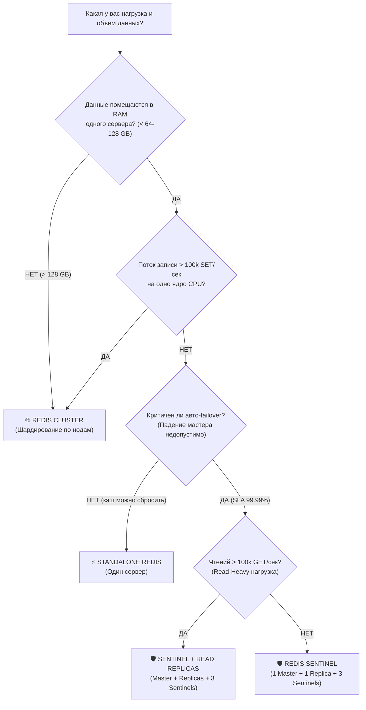

# 🌐 МАСШТАБИРОВАНИЕ REDIS: Репликация vs Sentinel vs Cluster

> **Руководство для Senior / Lead Backend разработчика**  
> Всё о том, как масштабируется Redis, при каких условиях переходить на шардирование, как работают Hash Slots, и что спрашивают на собеседованиях.

---

## 🗺️ 3 ступени масштабирования: Эволюция Redis

```
┌────────────────────────────────────────────────────────────────────────┐
│                        3 СТУПЕНИ МАСШТАБИРОВАНИЯ                       │
├───────────────────┬────────────────────────┬───────────────────────────┤
│ 1. РЕПЛИКАЦИЯ     │ 2. REDIS SENTINEL      │ 3. REDIS CLUSTER          │
│ (Master-Replica)  │ (Высокая доступность)  │ (Горизонтальный шардинг)  │
├───────────────────┼────────────────────────┼───────────────────────────┤
│ • Масштабирует    │ • Автоматический       │ • Масштабирует ОБЪЕМ RAM  │
│   ЧТЕНИЕ (GET)    │   Failover (99.99% SLA)│   (100 GB .. 10 TB+)      │
│ • Запись в Master │ • Мониторит Master     │ • Масштабирует ЗАПИСЬ     │
│ • Реплики async   │ • 3 ноды-стража        │   (500k+ SET/sec)         │
│ • ❌ Нет авто-    │ • ❌ Запись всё ещё    │ • 16 384 Hash Slots       │
│   failover        │   в 1 ноду (RAM <64GB) │ • ❌ Нет cross-slot trans.│
└───────────────────┴────────────────────────┴───────────────────────────┘
```

---

## 🚦 Дерево принятия решений (Когда что выбирать?)



---

## 📌 1. Репликация (Master-Replica) — Масштабирование ЧТЕНИЯ

### Суть
Один **Master** принимает команды записи (`SET`, `HSET`, `DEL`).  
Одна или несколько **Replica** (Slave) получают копию данных и отдают только чтение (`GET`, `HGETALL`).

### Когда применять:
* Нагрузка **Read-Heavy**: 90% запросов на чтение, 10% на запись.
* Чтения настолько много (200k+ RPS), что одно ядро CPU мастера не справляется.

### Как работает:
1. Реплика подключается к Мастеру: команда `REPLICAOF master_ip 6379`.
2. **Full Sync:** Мастер делает снимок `BGSAVE` (RDB-файл), передает его реплике по сети.
3. **Replication Stream:** Все новые команды мастер асинхронно пересылает репликам через кольцевой буфер `repl-backlog`.

### ⚠️ Минусы и ловушки:
* **Асинхронность (Replica Lag):** Записали на Master → сразу прочитали с Replica → данных ещё нет (отставание несколько миллисекунд).
* **НЕТ автоматического восстановления:** Если Master упал ночью — запись останавливается. Сайт лежит, пока инженер вручную не выполнит `REPLICAOF NO ONE` на реплике.

---

## 📌 2. Redis Sentinel — Автоматический Failover (High Availability)

### Суть
**Sentinel (Часовой)** — это отдельный легковесный процесс Redis, который следит за здоровьем Master и Replica.

```
┌────────────────────────────────────────────────────────┐
│                   REDIS SENTINEL                       │
│                                                        │
│   [ Sentinel 1 ]     [ Sentinel 2 ]     [ Sentinel 3 ] │
│         │                  │                  │        │
│         └──────────┬───────┴──────────┬───────┘        │
│                    │  (Опрос по PING) │                │
│                    ▼                  ▼                │
│             ┌──────────────┐   ┌──────────────┐        │
│             │    MASTER    │──▶│   REPLICA    │        │
│             └──────────────┘   └──────────────┘        │
└────────────────────────────────────────────────────────┘
```

### Как работает Failover:
1. **SDOWN (Subjectively Down):** Sentinel 1 видит, что Master не отвечает 5 секунд (`down-after-milliseconds`).
2. **ODOWN (Objectively Down):** Sentinel 1 опрашивает других часовых. Если набрался **Кворум (2 из 3)**, мастер официально признаётся мёртвым.
3. **Выборы лидера:** Часовые выбирают среди себя Лидера (алгоритм Raft).
4. **Промоушн реплики:** Лидер выбирает лучшую реплику (с минимальным `replica-lag`) и превращает её в нового Мастера (`REPLICAOF NO ONE`).
5. **Клиенты переключаются сами:** NestJS клиент подключён к Sentinel, получает адрес нового Мастера и продолжает слать запросы!

### Почему Sentinel всегда нечётное число (3, 5)?
Для избежания **Split-Brain (разрыва мозга)** при сетевых изоляциях: большинству (кворуму 2 из 3) всегда удаётся договориться.

---

## 📌 3. Redis Cluster — Шардирование (Горизонтальное масштабирование)

### Когда переходить на Cluster? (Критерии перехода)
1. **Объём данных > RAM одного сервера:** Нужно хранить 500 ГБ кэша, а серверы максимум по 128 ГБ.
2. **Поток записи > 100 000–150 000 SET/sec:** Одно ядро CPU мастера загружено на 100%.
3. **Упёрлись в сеть:** Сетевая карта одного сервера не пропускает трафик.

---

### Архитектура Hash Slots (16 384 слота)

В Redis Cluster данные делятся **не по серверам, а по слотам**.  
Всего существует ровно **16 384 слота (от 0 до 16383)**.

```
┌─────────────────────────────────────────────────────────────────┐
│                     16 384 HASH SLOTS                           │
│                                                                 │
│   Шард 1 (Master A): Слоты     0 ..  5460   (~5.4k слотов)      │
│   Шард 2 (Master B): Слоты  5461 .. 10922   (~5.4k слотов)      │
│   Шард 3 (Master C): Слоты 10923 .. 16383   (~5.4k слотов)      │
└─────────────────────────────────────────────────────────────────┘
```

#### Формула расчёта слота:
$$\text{Slot} = \text{CRC16}(\text{key}) \pmod{16384}$$

**Пример:**
* Ключ `user:1001` → CRC16 = `22033` → $22033 \pmod{16384} = 5649$ → попадает на **Шард 2**.
* Ключ `catalog:items` → CRC16 = `18021` → $18021 \pmod{16384} = 1637$ → попадает на **Шард 1**.

#### Почему именно 16 384 слота, а не 65 536?
> ⚠️ **ТОП-вопрос на Lead собеседовании!**
> 1. Ноды кластера постоянно обмениваются состоянием (Gossip Protocol / Heartbeat).
> 2. Массив из 16 384 слотов в битовой маске занимает ровно **2 КБ** ($16384 / 8 = 2048$ байт).
> 3. Если бы слотов было 65 536 — пакет heartbeat весил бы 8 КБ, что создавало бы огромный сетевой оверхед.
> 4. 16 384 слотов достаточно для кластера до 1 000 серверов (по ~16 слотов на ноду).

---

### Редиректы: `MOVED` vs `ASK`

Клиент подключается к любой ноде кластера:
* **`MOVED 5649 192.168.1.11:6379`** — постоянный редирект.  
  Нода говорит: *«Этот слот переехал на Ноду B навсегда. Обнови у себя карту слотов и шли туда»*.
* **`ASK 5649 192.168.1.11:6379`** — временный редирект (идёт миграция данных / Resharding).  
  Нода говорит: *«Этот конкретный ключ сейчас временно мигрирует на Ноду B. Сходи туда за этим запросом, но карту не обновляй»*.

---

### Секретное оружие: Hash Tags `{...}`

В Redis Cluster **запрещены транзакции `MULTI/EXEC` и операции `MGET/MSET`**, если ключи лежат в разных слотах:
```bash
MGET user:1001 order:500
# ❌ ОШИБКА: CROSSSLOT Keys in request don't hash to the same slot
```

#### Решение — Hash Tags:
Если в ключе есть фигурные скобки `{...}`, Redis вычисляет CRC16 **только от строки внутри скобок**:
* `{user:1001}:profile` → хэшируется строка `user:1001` → Слот **5649**
* `{user:1001}:orders`  → хэшируется строка `user:1001` → Слот **5649**
* `{user:1001}:cart`    → хэшируется строка `user:1001` → Слот **5649**

Все три ключа гарантированно попадут на **один и тот же шард**, и транзакции между ними будут работать идеально!

---

## 💻 Подключение в NestJS (ioredis)

### Подключение к Redis Sentinel:
```typescript
import Redis from 'ioredis';

const redis = new Redis({
  sentinels: [
    { host: 'sentinel-1.prod', port: 26379 },
    { host: 'sentinel-2.prod', port: 26379 },
    { host: 'sentinel-3.prod', port: 26379 },
  ],
  name: 'mymaster', // имя кластера из sentinel.conf
  password: 'secret_password',
  // Автоматический переконнект при переключении мастера
  reconnectOnError: (err) => err.message.includes('READONLY'),
});
```

### Подключение к Redis Cluster:
```typescript
import Redis from 'ioredis';

const cluster = new Redis.Cluster([
  { host: 'redis-node-1.prod', port: 6379 },
  { host: 'redis-node-2.prod', port: 6379 },
  { host: 'redis-node-3.prod', port: 6379 },
], {
  redisOptions: { password: 'secret_password' },
  // Автообновление карты слотов каждые 5 сек (для обработки MOVED)
  slotsRefreshTimeout: 2000,
});
```

---

## 🧪 Интерактивный эндпоинт в проекте

В контроллере реализован живой шаг для демонстрации:
```bash
curl http://localhost:3000/redis/learn/22-scaling
```

Он в реальном времени:
1. Опрашивает текущую ноду через `INFO replication`.
2. Вычисляет CRC16 Hash Slots для ключей.
3. Показывает магию Hash Tags `{user:1001}` в действии.
4. Возвращает сводную таблицу масштабирования.
